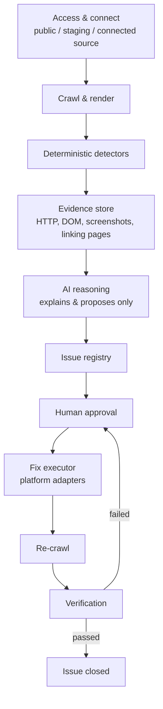

# progrowth-sitefix-agent

An internal AI-assisted agent that inspects any client website, flags
technical, SEO, and accessibility faults with evidence, and — only after
human approval — applies the fix and verifies it actually worked.

This is **not** a website builder and **not** a CMS. It is a technical QA
and error-rectification agent that sits on top of a site that already
exists.

---

## 1. Why this exists

Today, when a client site has a problem, the workflow is entirely manual:
someone inspects the site, hunts for broken pages, checks SEO and metadata
by hand, decides what to change, makes the change, and manually re-checks
that it worked. This agent is built to take over that loop — detection,
explanation, proposal, approval, execution, and verification — without
removing the human from any decision that matters.

## 2. The one rule the whole design follows

> **The AI never decides facts. It only explains and proposes.**

A crawler and a set of deterministic checks establish every raw fact (a
status code, a canonical tag, a missing title). Only after a fact exists
does the AI layer explain it in plain language and suggest a fix. The AI
never crawls, never invents a fact, never applies a fix, and never closes
an issue. A human approves every fix before it ships, and a separate
verification step — not the act of applying the fix — is what closes an
issue.

## 3. Architecture

Each stage produces a typed artifact the next stage consumes. Nothing
downstream re-derives a fact a stage above it already established, and
nothing in the pipeline can skip the human-approval step.

## 4. What Phase 1 detects

| Category | What we check for |
|---|---|
| HTTP and URLs | 404 / 410 / 5xx pages, broken links, redirect chains and loops, HTTP/HTTPS and www mismatches |
| Soft 404s | Pages that return 200 OK but read like an error page (wrong title, wrong H1, error-like body text) |
| SEO and metadata | Missing or duplicate titles and meta descriptions, missing H1, broken heading structure |
| Canonical tags | Missing or duplicate canonical tag, canonical pointing to a 404 or to a redirect |
| Sitemap and robots | robots.txt errors, sitemap URLs that error, redirect, or are wrongly marked noindex |
| Images | Broken images, missing alt text, oversized files, HTTP images on HTTPS pages |
| Links | Broken or redirected internal/external links, plus every page that links to the broken one |
| Structured data and accessibility | Invalid schema/Open Graph tags, missing form labels, heading structure, contrast signals |

Every finding carries evidence — a status code, a screenshot, or a DOM
snippet — never a guess. This list is adapted from the overlapping
categories used by established site-audit tools (Semrush, Ahrefs,
Sitebulb), consolidated into a set sized for Phase 1 rather than a full
clone of a mature enterprise crawler.

## 5. How a fix is classified

| Fix category | Examples | Who decides the content | Who executes |
|---|---|---|---|
| Safe / deterministic | Redirecting a known-broken link to its one obvious replacement, removing byte-identical duplicate meta tags | A rule engine — the answer is unambiguous | Adapter, after human approval |
| AI-proposed, human-approved | Generating a meta description, choosing a redirect target among several candidates, generating alt text | AI, from evidence only | Adapter, after human approval |
| Detected, not yet automatable | Most performance and accessibility findings; any platform without a working adapter | N/A | Routed to a manual engineering ticket |
| Never autonomous | Deleting pages, changing auth, modifying databases, payment logic, DNS, destructive production changes | N/A | Never this system |

Classification goes by **what the change touches** (which file, API, or
table), not by the issue's category label alone.

## 6. Access model

| Level | What it is | Unlocks |
|---|---|---|
| 1 — Public | The live URL, no credentials | Detection only |
| 2 — Staging | Login credentials or custom headers for a gated site | Detection on pre-release environments |
| 3 — Connected source | GitHub, WordPress, or Webflow access | Required before any fix can be executed |

## 7. Platform adapters

| Platform | How we connect | How a fix lands |
|---|---|---|
| **GitHub sites — pilot** | Scoped token or GitHub App, one repo only | Branch, patch, diff, pull request, CI, human merges |
| WordPress | REST API, scoped application password | Title/meta/alt text: direct write. Canonical: via the site's SEO plugin. Redirects: need a redirect plugin or server rule |
| Webflow | CMS API; Designer API for structural fields | Content fields via CMS API. Redirects and canonical usually need a manual Designer step |
| Anything else | No adapter built yet | A fully-specified ticket a human applies by hand |

Behind the GitHub adapter, any framework in the repo rides the same
branch/PR/CI flow: Next.js, React, static HTML, PHP/Laravel, custom CMS.
Vercel, Netlify, and Cloudflare sit behind that same flow as deploy
targets. The AI never holds these credentials — only the adapter layer
does, and only after a human approves.

## 8. Phase roadmap

- **Phase 1 (this repo, current focus):** detect, explain, propose, get
  human approval, execute only low-risk fixes, verify. No content editing,
  no CMS, no autonomous production changes.
- **Phase 2 (later, separate effort):** an editable CMS layer — page
  content, sections, images. Deliberately kept out of Phase 1's schema and
  UI so it can be added later without a rebuild; see Section 9.

### Phase 1 — in scope
- Crawl and render an existing live or staging site
- Detect technical, SEO, and accessibility issues (Section 4)
- Explain and propose fixes with evidence
- Route every fix through human approval
- Execute only low-risk fixes: redirects, metadata, alt text, canonical
- Re-crawl and verify before closing an issue

### Phase 1 — out of scope, for now
- A visual CMS or content editor
- Publishing new pages or sections
- Autonomous, unapproved production changes
- Full performance re-engineering (bundling, re-compression)
- Content strategy, keywords, link building
- Multi-agent orchestration, Kubernetes, before we need it

## 9. Tech stack

| Layer | Tool | Cost |
|---|---|---|
| Crawler and renderer | Playwright | Free |
| Backend and orchestration | FastAPI or NestJS | Free |
| Issue registry | PostgreSQL | Free, plus hosting |
| Job queue | Redis + BullMQ / Celery | Free |
| Evidence storage | S3-compatible storage | Pay-as-you-go |
| AI reasoning | Claude API | Paid, usage-based |
| Fix adapter | GitHub REST API | Free |
| Secrets | AWS / GCP Secrets Manager | Pay-as-you-go |
| Dashboard | React + Tailwind | Free |
| Hosting | Docker Compose, one VM | Monthly server fee |

Only the Claude API is a true recurring software cost — everything else is
open-source.

## 10. MVP timeline — 8 weeks to one working loop

| Week | Milestone |
|---|---|
| 1 | Crawler and renderer working on one real pilot site |
| 2 | Evidence storage and the first four detectors |
| 3 | Issue registry with full schema and dedup logic |
| 4 | AI layer: explanations and fix proposals |
| 5 | Approval queue, basic internal UI |
| 6–7 | GitHub adapter: branch, diff, pull request, CI |
| 8 | Verification engine: re-crawl, close or reopen — loop closed end to end |

**The MVP, in one sentence:** detect a broken link, explain it, propose a
fix, get it approved, open a real GitHub pull request, merge it, and
confirm it's actually fixed — on one real, GitHub-hosted pilot site, with
four issue types, proving every stage of the architecture end to end.

## 11. Security principles

- Every client site is its own isolated tenant — separate credentials,
  separate evidence storage, separate issue registry partition.
- Credentials live only in a secrets manager, never in code, config, or
  logs.
- Each adapter requests the narrowest possible scope (one repo, one
  application-password user) — never admin or org-wide access.
- The AI reasoning service never holds fix-execution credentials; that is
  an architectural boundary, not a permissions setting.
- Every fix requires human approval. No silent auto-apply exists in
  Phase 1, even for "safe/deterministic" fixes.
- Every stage — detection, proposal, approval, execution, verification —
  is logged append-only and tied to the issue it belongs to.

## 12. Contributing

See [`.github/PULL_REQUEST_TEMPLATE.md`](.github/PULL_REQUEST_TEMPLATE.md)
— every PR must state what it does, how the branch was tested, the
outcome, and which part of the roadmap above it closes. PRs that don't
fill this in will be asked to before review.

## 13. Status

Currently in **Phase 1, Week 1**: building the crawler and renderer
against the pilot site. See the repo's open issues and PRs for current
progress against the timeline in Section 10.
