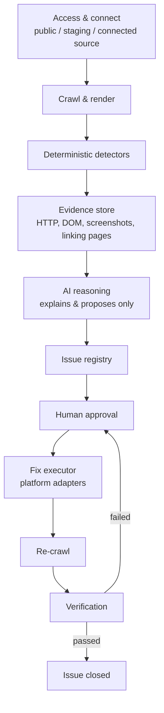

# progrowth-sitefix-agent

An internal AI-assisted agent that inspects any client website, flags
technical, SEO, and accessibility faults with evidence, and, only after
human approval, applies the fix and verifies it actually worked.

This is **not** a website builder and **not** a CMS. It is a technical QA
and error-rectification agent that sits on top of a site that already
exists.

**Status:** Phase 1, Day 6 of 12 complete. See [Current sprint](#10-current-sprint-oct-5-to-oct-17-2026).

---

## 1. Why this exists

Today, when a client site has a problem, the workflow is entirely manual:
someone inspects the site, hunts for broken pages, checks SEO and metadata
by hand, decides what to change, makes the change, and manually re-checks
that it worked. This agent is built to take over that loop (detection,
explanation, proposal, approval, execution, and verification) without
removing the human from any decision that matters.

## 2. The one rule the whole design follows

> **The AI never decides facts. It only explains and proposes.**

A crawler and a set of deterministic checks establish every raw fact (a
status code, a canonical tag, a missing title). Only after a fact exists
does the AI layer explain it in plain language and suggest a fix. The AI
never crawls, never invents a fact, never applies a fix, and never closes
an issue. A human approves every fix before it ships, and a separate
verification step, not the act of applying the fix, is what closes an
issue.

## 3. Architecture



Each stage produces a typed artifact the next stage consumes. Nothing
downstream re-derives a fact a stage above it already established, and
nothing in the pipeline can skip the human-approval step.

## 4. What Phase 1 detects

| Category | What we check for |
|---|---|
| HTTP and URLs | 404 / 410 / 5xx pages, broken links, redirect chains and loops, redirects that end in an error, HTTP/HTTPS and www mismatches |
| Soft 404s | Pages that return 200 OK but read like an error page (not-found title or H1, near-empty body) |
| SEO: titles & descriptions | Missing, duplicate, too long or too short titles and meta descriptions; missing or multiple H1; heading levels that skip; tags that only exist after JavaScript |
| SEO: indexing | Missing or duplicate canonical tag, canonical pointing to a 404 or to a redirect; pages marked `noindex` / `nofollow` (meta tag or `X-Robots-Tag` header) |
| Social sharing | No Open Graph tags, essential ones missing (title, description, image), share image that does not load |
| Page setup | No viewport tag (not mobile-friendly), no `lang` on `<html>` |
| Content | Thin pages (under 200 words), near-duplicate pages (85%+ the same text once menus and footers are removed), leftover placeholder text (lorem ipsum, unfilled `{{template}}` tags), repeated words ("the the"), spelling and grammar mistakes (quoted with a corrected version) |
| Sitemap and robots | robots.txt errors, sitemap URLs that error, redirect, or are wrongly marked noindex |
| Images | Broken images, missing / unhelpful / too-long alt text, oversized files, HTTP images on HTTPS pages |
| Links | Broken or redirected internal/external links, plus every page that links to the broken one |
| Structured data and accessibility | Invalid schema (JSON-LD), missing form labels, contrast signals |

**Why the head checks are split this way.** Almost everything in a page's
`<head>` is "metadata", so that word is not a useful group. Checks are grouped
by **who reads the tag**, because that decides the impact and who fixes it:
Google's results page (titles & descriptions), Google's crawler (indexing),
link previews on Facebook, LinkedIn, WhatsApp and X (social sharing), and
browsers, phones and screen readers (page setup). Page *text* is a fifth
group, **Content**, read by the people visiting the page. The code follows the same
split: `lib/head.js` only reads the page, and each group has its own rules
file (`lib/seo.js`, `lib/social.js`, `lib/page-setup.js`, `lib/content.js`).

Every finding carries evidence (a status code, a screenshot, or a DOM
snippet), never a guess. This list is adapted from the overlapping
categories used by established site-audit tools (Semrush, Ahrefs,
Sitebulb), consolidated into a set sized for Phase 1 rather than a full
clone of a mature enterprise crawler.

**Coverage in the current sprint (to Oct 17):** HTTP/URLs, links, redirects,
metadata, canonical tags and soft 404s are built and tested; image
checks are built and tested (broken images, alt text, mixed content, oversized files); robots.txt parsing,
structured data and accessibility follow in the next block.

## 5. How a fix is classified

| Fix category | Examples | Who decides the content | Who executes |
|---|---|---|---|
| Safe / deterministic | Redirecting a known-broken link to its one obvious replacement, removing byte-identical duplicate meta tags | A rule engine; the answer is unambiguous | Adapter, after human approval |
| AI-proposed, human-approved | Generating a meta description, choosing a redirect target among several candidates, generating alt text | AI, from evidence only | Adapter, after human approval |
| Detected, not yet automatable | Most performance and accessibility findings; any platform without a working adapter | N/A | Routed to a manual engineering ticket |
| Never autonomous | Deleting pages, changing auth, modifying databases, payment logic, DNS, destructive production changes | N/A | Never this system |

Classification goes by **what the change touches** (which file, API, or
table), not by the issue's category label alone.

## 6. Access model and platform adapters

| Level | What it is | Unlocks |
|---|---|---|
| 1: Public | The live URL, no credentials | Detection only |
| 2: Staging | Login credentials or custom headers for a gated site | Detection on pre-release environments |
| 3: Connected source | GitHub, WordPress, or Webflow access | Required before any fix can be executed |

| Platform | How we connect | How a fix lands |
|---|---|---|
| **GitHub sites (pilot)** | Scoped token or GitHub App, one repo only | Branch, patch, diff, pull request, CI, human merges |
| WordPress | REST API, scoped application password | Title/meta/alt text: direct write. Canonical: only if the site's SEO plugin exposes it for writing (Yoast's REST API is read-only by default). Redirects: need a redirect plugin or server rule |
| Webflow | CMS API; Designer API for structural fields | Content fields via CMS API. Redirects and canonical usually need a manual Designer step |
| Anything else | No adapter built yet | A fully-specified ticket a human applies by hand |

Behind the GitHub adapter, any framework in the repo rides the same
branch/PR/CI flow: Next.js, React, static HTML, PHP/Laravel, custom CMS.
The AI never holds these credentials; only the adapter layer does, and
only after a human approves. None of the adapters are built yet.

## 7. Phase boundaries

- **Phase 1 (this repo):** detect, explain, propose, get human approval,
  execute only low-risk fixes, verify. No content editing, no CMS, no
  autonomous production changes.
- **Phase 2 (later, separate effort):** an editable CMS layer for page
  content, sections and images. Deliberately kept out of Phase 1's schema
  and UI so it can be added later without a rebuild.

**Out of scope for Phase 1:** a visual CMS or content editor, publishing
new pages, autonomous or unapproved production changes, full performance
re-engineering, content strategy work, and heavy infrastructure
(multi-agent orchestration, Kubernetes) before it is needed.

## 8. Tech stack

| Layer | Tool | Status |
|---|---|---|
| Crawler and renderer | Node.js, Playwright (headless Chromium) | In use |
| Test fixture and scoring | Node.js built-ins (`http`, `fetch`) | In use |
| Unit tests | `node:test` (built in) | In use |
| CI | GitHub Actions | In use |
| Issue registry | JSON file now (`issues.json`, one run), PostgreSQL later | In use (v0) |
| Chat-first UI | Vanilla HTML, CSS and JS (no framework), Node.js HTTP + SSE server, no new dependencies | In use (Day 10) |
| AI reasoning | OpenAI API (`gpt-4o-mini` by default; any OpenAI-compatible endpoint), behind guardrails; a mock provider for tests | In use (v1: explanations, fixes, chat) |
| PDF report | Playwright's Chromium (print to PDF) | In use |
| Fix adapter | GitHub REST API | Planned |
| Secrets | GitHub Actions secrets now, a secrets manager later | Planned |
| Dashboard | React + Tailwind | Planned |

## 9. Repository layout

```
progrowth-sitefix-agent/
├── .github/
│   ├── PULL_REQUEST_TEMPLATE.md      every PR must fill this in
│   └── workflows/
│       ├── crawl.yml                  run the crawler on any URL (manual)
│       └── fixture-selfcheck.yml      unit tests, then crawl and score the fixture on every change
├── fixture/                           controlled test site with planted faults
│   ├── generate-site.js               writes the 24 HTML pages and the small images into site/
│   ├── server.js                      serves them with real HTTP redirects (and generates the oversized test image)
│   ├── selfcheck.js                   proves the fixture behaves as claimed
│   ├── score.js                       scores crawler output against the planted issues
│   ├── expected-issues.json           ground truth: the 30 planted issues
│   └── site/                          generated pages
├── lib/
│   ├── redirects.js                   follow redirects hop by hop, classify them, site-level checks
│   ├── head.js                        read a page's head into facts: title, description, canonical, robots, Open Graph, viewport, lang, headings
│   ├── seo.js                         SEO rules: titles, descriptions, H1, heading order, canonical, noindex / nofollow
│   ├── social.js                      social sharing rules: Open Graph tags, broken share image
│   ├── page-setup.js                  page setup rules: viewport, lang
│   ├── soft404.js                     soft-404 rule: says "not found" plus a second signal
│   ├── copy.js                        spelling and grammar: built-in misspellings list + AI proofreading with guardrails
│   ├── content.js                     content rules: boilerplate removal, thin pages, near-duplicates (MinHash), placeholder text, repeated words
│   ├── images.js                      image rules: pick the real src, decorative or not, alt text, size, mixed content
│   ├── issues.js                      issue schema, severity and fix-class catalog, registry builder and validator
│   ├── triage.js                      priority (P1/P2/P3), who fixes it, effort, quick wins
│   ├── explain-templates.js           standard plain-language guidance for every issue type (used when AI is off)
│   ├── explain.js                     AI explanations and suggested fixes, with guardrails and a cache
│   ├── chat.js                        answers questions from one report only; checks every cited issue id
│   ├── report-html.js                 the printable report (HTML that report.js turns into the PDF)
│   ├── ai-provider.js                 the only code that talks to an AI: OpenAI or the mock, from .env
│   ├── ai-mock.js                     the mock AI (no key, no network) for demos, tests and CI
│   └── env.js                         reads .env without overriding real environment variables
├── test/
│   ├── redirects.test.js              unit tests for lib/redirects.js
│   ├── head.test.js                   unit tests for lib/head.js
│   ├── seo.test.js                    unit tests for lib/seo.js
│   ├── social.test.js                 unit tests for lib/social.js
│   ├── page-setup.test.js             unit tests for lib/page-setup.js
│   ├── soft404.test.js                unit tests for lib/soft404.js
│   ├── copy.test.js                   misspellings list, quote-must-exist and site-vocabulary guardrails, caching
│   ├── content.test.js                unit tests for lib/content.js
│   ├── images.test.js                 unit tests for lib/images.js
│   ├── issues.test.js                 unit tests for lib/issues.js
│   ├── triage.test.js                 priority, effort, owner; every type has a rule and guidance
│   ├── explain.test.js                guardrails (invented URLs, bad ids, value lengths), fallbacks, cache
│   ├── chat.test.js                   context selection, cited-id checks, error handling
│   ├── ai-provider.test.js            .env loading, config, OpenAI request format and retries (fake server)
│   └── report-html.test.js            report sections, escaping, screenshots, caps (npm test runs them all)
├── ui/                                chat-first internal website audit agent UI
│   ├── build-index.js                 source of the page: edit this, then run it to regenerate index.html
│   ├── index.html                     generated single-page chat interface (do not edit by hand)
│   └── server.js                      Node.js HTTP server: runs crawl.js then report.js, streams both over SSE, serves the PDF and the chat
├── crawl.js                           the crawler (page crawl, link checks, redirect, metadata and soft-404 analysis, then builds the issue registry)
├── report.js                        after a crawl: triage, explanations, screenshots, then audit-report/ (JSON, HTML, PDF)
├── .env.example                     template for .env (your API key; .env itself is never committed)
├── package.json
├── .gitignore
└── README.md
```

## 10. Current sprint: Oct 5 to Oct 17, 2026

Goal: turn the Week 1 crawler into a tested detection engine that records
every finding with evidence in an issue registry, with an AI layer that
explains each finding from that evidence only. 12 working days, Monday to
Saturday. Fridays are a half day of build plus review preparation.

| Day | Date | Aim | Status |
|---|---|---|---|
| 1 | Mon Oct 5 | Test fixture with planted faults and ground truth | **Done** |
| 2 | Tue Oct 6 | Crawl coverage: configurable page cap, check every link directly, found-on map | **Done** |
| 3 | Wed Oct 7 | HTTP and redirect detector | **Done** |
| 4 | Thu Oct 8 | Metadata and canonical detector | **Done** |
| 5 | Fri Oct 9 | Soft-404 rule, then Week 1 review prep | **Done** |
| 6 | Sat Oct 10 | Evidence capture and issue schema, registry v0 | **Done** |
| 7 | Mon Oct 12 | Registry across runs, image and sitemap checks | Image checks **Done**; registry across runs and sitemap checks planned |
| 8 | Tue Oct 13 | AI layer: input and output contract | **Done** (explanations, fixes, chat) |
| 9 | Wed Oct 14 | AI layer: guardrails and evaluation | **Done** (guardrails, fixture run with mock AI in CI) |
| 10 | Thu Oct 15 | Readable report: chat-first audit UI (SiteFix) | **Done** |
| 11 | Fri Oct 16 | Live-site runs (faster full-site crawl), then Week 2 review prep | In progress |
| 12 | Sat Oct 17 | Validation and close-out | Planned |

Beyond this sprint, the Phase 1 plan continues with the approval queue,
the GitHub adapter and the verification engine (re-crawl, then close or
reopen), which together complete the detect-to-verify loop end to end.

## 11. Getting started

Requirements: Node.js 22 or newer, Git.

```bash
git clone https://github.com/indhuja-elumalai/progrowth-sitefix-agent.git
cd progrowth-sitefix-agent
npm install
npx playwright install chromium
```

### Run the chat-first UI (SiteFix)

A chat-style front end for the crawler: paste a URL, watch the crawl stream
in, then read the findings from `issues.json` as grouped, expandable cards.

```bash
npm run ui                        # http://localhost:3000
node ui/server.js --port 3001     # any other port
```

The UI runs the crawler with no page cap, so a large site takes a while;
the log shows how many pages are still queued.

To try it on the fixture, start `node fixture/server.js` in a second
terminal, then click the `localhost:4000` chip under the input box.

What you get:

1. **One input.** The URL box is focused on load. Press Enter (or the round arrow button)
   to send; the box clears like a sent message. Bare domains get `https://` added (`http://` for localhost).
2. **Live progress.** `crawl.js` output streams into the chat over
   Server-Sent Events (`/api/stream/:runId`), with a pill per detector
   (links, redirects, metadata, soft 404, issue registry).
3. **Summary card.** Start URL, pages crawled, time taken, whether the page
   cap was hit, and counts by severity.
4. **Issue cards grouped by category.** Each shows the issue type, severity,
   affected URL, detail and fix class. Click a card to see its evidence
   (HTTP status, redirect chain, head tags, soft-404 signals) and the pages
   that link to it (`foundOn`, first five).
5. **Explanations, priorities and fixes.** After the crawl, `report.js` runs
   automatically. Categories start collapsed; open one to see its issues,
   sorted P1 first. Each issue shows its priority, effort, who fixes it and
   whether it is a quick win, and its evidence opens with: in plain words,
   why it matters, how to fix, a suggested value (title, description or alt
   text) with a Copy button, and a screenshot.
6. **PDF report.** "Open PDF report" on the summary card opens the full
   report: a cover with totals and what to fix first, then one section per
   issue type with the explanation, fix steps, every instance and screenshots
   (the broken link or image outlined in red).
7. **Chat about the report.** Type a question in the same box ("what should I
   fix first?", "which images are broken?", "what is wrong with the austin
   page?"). Answers use only this inspection's data, cite the issues they
   used (click a citation to open that issue), and say so when the report
   does not cover something. A URL in the box still starts a new inspection.

Guardrails in `ui/server.js`: it listens on `127.0.0.1` only (set
`SITEFIX_UI_HOST` to change that), runs one inspection at a time (every run
writes `issues.json` in the project root), and only returns results for a
run that exited cleanly, so a failed crawl never shows the previous site's
issues.

To change the page, edit `ui/build-index.js` and run
`node ui/build-index.js` to regenerate `ui/index.html`. Commit both.

### AI layer: set up your API key

The AI explains each issue in plain language, writes the fix and suggested
values, and answers chat questions. Without a key everything still works with
SiteFix's standard guidance, except the chat.

```bash
cp .env.example .env        # .env is in .gitignore: it is never committed
open -e .env                # or any editor; set OPENAI_API_KEY=sk-...
npm run ui                  # the server prints "AI: openai (gpt-4o-mini)" when the key is picked up
```

Settings in `.env`: `OPENAI_API_KEY` (required for AI), `AI_MODEL` (default
`gpt-4o-mini`; any chat model on your account), `AI_PROVIDER` (`openai`,
`mock` or `none`), `AI_BASE_URL` (any OpenAI-compatible endpoint),
`SITEFIX_ALLOW_WORDS` (comma-separated words the spelling check must never flag,
such as brand or product names). A real
environment variable always wins over `.env`. Restart the UI server after
changing `.env`. For the GitHub Action, add the key as a repository secret
named `OPENAI_API_KEY`.

`AI_PROVIDER=mock` runs the whole pipeline with no key and no cost (fixed,
evidence-based answers); CI uses it on every push.

How it stays real (`lib/explain.js`, `lib/chat.js`):

- One AI call per issue **type** (up to 8 instances each), so 300 redirect
  chains cost one call, not 300. Answers are cached in
  `.sitefix-ai-cache.json`, so re-running a report costs nothing.
- The AI sees only the issue's own evidence, never the raw page.
- Every answer is checked: valid JSON in the expected shape, length limits,
  **every URL it mentions must appear in the evidence**, issue ids must be
  real, suggested values must fit the rules (title 10-60 characters,
  description 50-160, alt text up to 125). Whatever fails a check is replaced
  by the standard guidance and the reason is logged.
- Chat answers come from this report only; issue ids not in the report are
  removed from the answer.
- Priority and effort are rule-based (`lib/triage.js`), not AI: the same issue
  always gets the same priority.

Run the report on its own after a crawl:

```bash
node report.js                       # AI if a key is set, else standard guidance
node report.js --no-ai               # standard guidance only
node report.js --no-screenshots      # faster, no screenshots
node report.js --max-screenshots 10  # default 30
```

It writes `audit-report/explained.json` (every issue with priority, effort,
owner, explanation, fix and suggested value), `audit-report/report.html`,
`audit-report/sitefix-report.pdf` and `audit-report/shots/`.

### Run the crawler via CLI

```bash
node crawl.js https://your-site.com            # whole site, no page cap
node crawl.js https://your-site.com --max-pages 50   # quick partial run
```

By default it crawls every internal page it can reach: everything linked
from the start page onwards, plus every URL in the site's sitemap
(`Sitemap:` lines in `robots.txt`, else `/sitemap.xml`, following sitemap
index files). Tracking parameters (`utm_*`, `gclid`, `fbclid`, ...) are
ignored when deciding whether a page was already crawled.

| Option | Default | What it does |
|---|---|---|
| `--max-pages N` | `0` (no cap) | Stop after N pages |
| `--concurrency N` | `4` | Pages rendered in the browser at the same time |
| `--link-concurrency N` | `8` | Link checks and redirect follows at the same time |
| `--settle-ms N` | `1500` | Longest wait for late JavaScript after a page loads |
| `--delay-ms N` | `150` | Pause after each request, per worker |
| `--no-sitemap` | off | Only follow links, skip the sitemap |
| `--no-ai` | off | Spelling check uses the built-in misspellings list only (no AI proofreading) |
| `--copy-ai` | off | Run AI proofreading on a local address too (it is skipped there by default) |

Lower `--concurrency` and `--link-concurrency` (or raise `--delay-ms`) for
small or fragile servers. It writes seven files:

- `report.json`: one entry per crawled page (raw vs rendered status, title,
  word count, broken resources, and the page's title, meta description, H1s,
  canonical and robots tags as read from both the raw and the rendered HTML).
- `links.json`: a summary, the site-level checks, the most common redirect
  destinations, and one entry per distinct link found, each checked directly
  (HEAD, falling back to GET on 403/405/501, redirects not followed). Every
  link lists the pages it was **found on** and is classed `ok`, `redirect`,
  `broken` (4xx/5xx), `unverified` (timeout, or blocked with 401/403/429/999)
  or `unreachable` (network error). Every redirecting link is followed hop by
  hop (up to 10) and typed as a `redirect-loop`, a `redirect-chain` (2 or more
  hops) or a `redirect-to-error`; a single redirect to a working page is
  recorded but not reported as an issue.
- `metadata.json`: for every page that loads (2xx), everything read from its
  head (title, description, H1s and heading outline, canonical, robots, Open
  Graph and Twitter tags, viewport, lang) and every SEO, social sharing and
  page setup issue found on it, each with a type, a severity and a one-line
  detail; a summary count per category and per type; and every distinct share
  image (`og:image`) with its HTTP check. The rules run on the **rendered** page (what a
  browser and Google end up with); `metadata-js-only` marks a title,
  description, H1 or canonical that is missing from the raw HTML and only
  appears after JavaScript runs.

- `issues.json`: **the issue registry**, and the file everything downstream reads.
  Every finding from every detector as one typed record, plus the run it came
  from and counts by severity and type (see [Issue records](#issue-records)).
- `soft404.json`: every page that shows at least one soft-404 signal, with the
  evidence and a `flagged` true/false. Candidates are every page that loaded
  plus up to 20 pages that are only ever reached through redirects (the
  crawler never lands on them directly).
- `content.json`: a summary (pages analysed, menu / footer lines ignored,
  thin, near-duplicate, placeholder, repeated-word counts) and, per page, its
  word count, its own word count once menus and footers are removed, its
  content issues and the pages it is near-identical to. The page text itself
  is not saved.
- `images.json`: a summary (images found, broken, alt problems, mixed
  content, oversized, size unknown) and one entry per distinct image URL:
  its status, where it redirects, its size and type, every page it is on,
  and which pages have missing, unhelpful or too-long alt text. Each image
  is checked once (HEAD, falling back to GET; redirects followed to the
  real file). Decorative images (`alt=""`, `role="presentation"`,
  `aria-hidden="true"`) skip the alt rules. Lazy-loaded images are read
  from `data-src` / `srcset` when `src` is only a placeholder. Limits:
  alt text up to 125 characters, files up to 300 KB (`IMAGE_LIMITS` in
  `lib/images.js`).

### Issue records

Each entry in `issues.json` is a measured fact, never AI output:

| Field | Meaning |
|---|---|
| `id` | Stable: the same type on the same URL always gets the same id (`ISS-` plus 10 hex characters), so a later run can recognise it |
| `type`, `category` | e.g. `canonical-broken-target`, "SEO: indexing" |
| `severity` | `high`, `medium` or `low`, from a catalog in `lib/issues.js` (a rule may override it) |
| `affectedUrl`, `foundOn` | The URL with the problem, and every page that links to it or, for page-level issues, the pages that lead to it |
| `detail` | One plain sentence stating the fact |
| `evidence` | The raw facts behind it: the HTTP status, the whole redirect chain, the page's title / description / H1 / canonical as read from the HTML (and the raw version if JavaScript changed it), the canonical's target status, or the soft-404 signals |
| `fixClass` | `deterministic`, `ai-proposed` or `not-automatable`: how a fix would be handled, never whether it needs approval (every fix does) |
| `status` | `open` for now; later days add acknowledged, fixed, verified and reopened |
| `firstSeenRun`, `lastSeenRun` | Run ids; in v0 both are the current run |

Every issue is validated when it is written, and `fixture/score.js` fails if any
issue is malformed. A type that is not in the catalog is refused, not guessed.

**Soft-404 rule:** a page that answers 200 is flagged only when it says it is an
error page (a not-found phrase or "404" in the title or H1) **and** at least
one other signal agrees: under 150 words, no H1, `noindex`, or 2 or more links
redirect into it. Title and H1 together count as one piece of evidence, and
supporting signals alone never flag a page, so an article about 404 errors or a
short valid page is left alone.

**SEO: titles & descriptions and SEO: indexing rules** (`lib/seo.js`): `title-missing`, `title-multiple`, `title-too-long` (over 60
characters), `title-too-short` (under 10), `description-missing`,
`description-multiple`, `description-too-long` (over 160), `description-too-short`
(under 50), `h1-missing`, `h1-multiple`, `canonical-missing`, `canonical-multiple`,
`canonical-broken-target` (the canonical URL returns 4xx/5xx or cannot be
reached), `canonical-redirect`, `title-duplicate`, `description-duplicate` and
`metadata-js-only`. The length limits are common SEO guidance, not facts about
any one site; they live in one place (`LIMITS` in `lib/seo.js`) and are
severity `low`. A page whose canonical points to a different URL is treated as
a declared copy and is left out of the duplicate checks.

Also in `lib/seo.js`: `heading-skip` (a heading goes more than one level
deeper than the one before, e.g. H2 then H4; going back up is fine; low),
`robots-noindex` (medium) and `robots-nofollow` (low), read from the robots
meta tag and the `X-Robots-Tag` header, including crawler-specific values
like `googlebot: noindex`. noindex is often deliberate (thank-you pages,
internal search), so these are detected only and a human decides.

**Social sharing rules** (`lib/social.js`): `og-missing` (no Open Graph tags
at all), `og-incomplete` (some, but `og:title`, `og:description` or
`og:image` missing) and `og-image-broken` (the share image returns 4xx/5xx;
each distinct image is checked once). Twitter/X falls back to Open Graph, so
`twitter:*` tags are shown in the evidence but not required.

**Page setup rules** (`lib/page-setup.js`): `viewport-missing` (medium) and
`lang-missing` (low).

**Content rules** (`lib/content.js`) read the page's visible text, line by
line, as a visitor sees it. A line that appears on at least half the pages
(menus, footers, shared blocks; only on sites with 4 or more pages) is treated
as boilerplate. `content-thin` (low): under 200 words of visible text; pages
already flagged as a soft 404 are skipped. `content-duplicate` (medium): two
pages whose own text (boilerplate removed, at least 50 words) shares 85% or
more of its 5-word phrases; candidates are found with MinHash so large sites
are not compared page by page, then confirmed with the exact score.
`content-placeholder` (high): lorem ipsum, unfilled template tags (`{{ }}`,
``, `${}`), fill-in brackets (`[insert ...]`), "your text here", sample
text, "page under construction", `TODO:` notes, and script output bugs
(`[object Object]`, `$NaN`, a line that is just "undefined").
`content-repeated-word` (low): the same word twice in a row, except words
that are legitimately doubled ("had had", "that that") and capitalised place
names ("Walla Walla"). Phase 1 does not edit page copy, so all four are
detected only.

Two site-level checks run on the start URL's host (skipped for localhost):
the `http://` version should redirect to `https://`, and the `www` / non-`www`
twin should redirect to the main host rather than serve the site itself.

It only reads; it never writes to the site.

Or run it with no local setup: GitHub, **Actions**, **Run Crawler**,
**Run workflow**, choose the branch, enter a URL and a `max_pages` value
(the workflow must exist on `main` to appear in that list).

**Known limits of the current crawler:** only `<a href>` links in the
rendered page are checked (not images, scripts or links added after user
interaction); query-string variants of a page are crawled as separate pages;
a link check that times out is reported as `unverified` without a second
attempt (two sonagroup.ae pages timed out at 10 s although `curl` shows them
answering in about 2 s); the soft-404 rule needs the page to say it is an error, so a soft 404 with a
normal title and content is not caught; metadata rules only judge pages the crawler visited
(so a capped crawl does not check every page); a canonical that points to a
redirecting URL is flagged but its final destination is not followed; and there
is no sitemap or image detection yet. Evidence is structured facts only; screenshots
and raw DOM snippets are not captured yet. The registry is one run's snapshot:
it does not yet compare with earlier runs.

### Run the unit tests and the test fixture

```bash
npm test                              # unit tests for every rule file and the registry (no server needed)
```

The fixture is a small site with a known set of planted faults, used to
measure whether each detector finds everything and nothing extra.

```bash
node fixture/generate-site.js         # write the pages (re-run after editing the generator)
node fixture/server.js                # terminal 1: site on :4000, "external" site on :4001
node fixture/selfcheck.js             # terminal 2: expects "All checks passed."
node crawl.js http://localhost:4000   # crawl the fixture
node fixture/score.js                 # compare the crawl with the answer key
```

It uses a local Node server rather than GitHub Pages because Pages cannot
serve real HTTP 301/302 redirects, so a redirect chain or loop cannot be
planted there. The same server runs in CI (`fixture-selfcheck.yml`), which
runs the unit tests, then crawls and scores the fixture on every push.

**Detected so far: all 30 planted issues, with 0 false positives** (CI
requires 30).

**The 30 planted issues** (`fixture/expected-issues.json`):

| ID | Planted fault |
|---|---|
| F-01 | Internal link returns 404 |
| F-02 | External link returns 404 |
| F-03 | Broken image (404) |
| F-04 | Redirect chain, 3 hops |
| F-05 | Redirect loop |
| F-06 | Soft 404 (200 OK, not-found title and H1, short body) |
| F-07 | Missing title |
| F-08, F-09 | Duplicate title (one entry per page) |
| F-10 | Canonical pointing at a 404 |
| F-11 | Redirect that ends in a 404 (`/old-page`) |
| F-12 | Soft 404 reached only through redirects: 200 OK, title says 404, two old links redirect into it (the sonagroup.ae pattern) |
| F-13 | Image with no alt attribute (`/img/office.svg` on `/image-alt.html`) |
| F-14 | Image whose alt text is a camera file name (`IMG_0042.jpg`) |
| F-15 | Image with alt text over 125 characters |
| F-16 | Image file over 300 KB (`/img/large-banner.svg` on `/large-image.html`, generated by the server) |
| F-17, F-18 | Page marked `noindex, nofollow` (`/noindex.html`) |
| F-19 | Heading levels skip, H2 then H4 (`/heading-skip.html`) |
| F-20 | No Open Graph tags (`/no-social.html`) |
| F-21 | Open Graph tags without `og:description` (`/social-partial.html`) |
| F-22 | Share image (`og:image`) that returns 404 |
| F-23, F-24 | No viewport tag and no `lang` (`/page-setup.html`) |
| F-25 | Thin page: `/contact.html`, 15 words (it is still the soft-404 negative control) |
| F-26, F-27 | Near-duplicate pages: `/location-austin.html` and `/location-denver.html`, one template with the city swapped |
| F-28 | Placeholder text: lorem ipsum and `{{ company_name }}` (`/draft-page.html`) |
| F-29 | Repeated word: "the the" (`/draft-page.html`) |
| F-30 | Spelling: "recieve" and "seperate" (`/typos-page.html`), caught by the built-in list |

Three control pages (`/`, `/about.html`, `/final.html`) must produce no
issues, and the self-check confirms every fixture title and description is
inside the length limits so the length rules stay quiet, and that every page
except the planted short ones has at least 200 words. `/contact.html` is
deliberately short but valid: it must be reported as thin (F-25) and never as
a soft 404. The shared filler paragraph on most pages doubles as a
boilerplate test: it must be ignored when pages are compared for
near-duplicates. `/image-alt.html` also carries two
decorative images (`alt=""` and `aria-hidden="true"`) that must not be
flagged. Not yet planted: http-to-https and www mismatches (they need real
hostnames, so they are covered by unit tests with a fake server), image mixed
content (the fixture runs on http, so it is covered by unit tests), and
sitemap and robots faults.

## 12. Results so far

### Week 1: crawler tested on two live sites

| Site | Finding |
|---|---|
| progrowth.services | Two crawler bugs: `&amp;` in titles read as a JavaScript change, and `/industries/` pages failing to render because they never reach network-idle. Both fixed (entity decoding; wait for `domcontentloaded`). |
| sonagroup.ae | Fixes confirmed on a second site. Found 5 real broken product thumbnails across 4 pages, all under `/public/products-images/thumb-image/`. |

### Day 1: baseline of the Week 1 crawler on the fixture

| Planted issue | What the crawler shows today |
|---|---|
| F-01 internal 404 | Visible (page entry with status 404), not labelled |
| F-02 external 404 | Missed |
| F-03 broken image | Visible (`404 /img/missing.jpg`), not labelled |
| F-04 redirect chain | Visible as a bare 301, hops not counted |
| F-05 redirect loop | Visible as a null render status, not labelled |
| F-06 soft 404 | Missed |
| F-07 missing title | Missed (a false `jsChangedTitle` flag appears instead) |
| F-08, F-09 duplicate titles | Missed |
| F-10 canonical to 404 | Missed |

**4 of 10 have a visible signal, 0 of 10 are labelled as issues, 6 are
missed.** `jsChangedTitle` also gave 4 false flags. Days 2 to 5 close
these gaps; every detector is measured against `expected-issues.json`.

### Day 2: crawl coverage

Page cap replaced by `--max-pages`; every link is now checked directly with
found-on pages. On the fixture the score went from 0 to **2 of 10 planted
issues found** (F-01 internal 404, F-02 external 404, both with the correct
found-on page) with **0 false positives**.

Real-site check (sonagroup.ae, 40 pages crawled with 4,290 still queued, mostly
`products.html` filter variants; 689 links checked): 0 broken, 97 redirecting.
Of the redirects, 9 internal links redirect to `/404.html`, which returns 200
with the title "404" and no H1 (a verified soft 404; `/faqs.html` alone is
linked from every crawled page), 85 are `products.html/?...` filter links that
301 because of a trailing slash, and 3 brand links redirect to the generic
products page. The homepage rejects HEAD requests with 403, so link checks now
retry with GET before judging.

### Day 3: redirect detector

Redirects are followed hop by hop and classified (loop, chain, ends in an
error); the http-to-https and www / non-www checks are in place and
unit-tested (13 tests). The fixture gained a planted fault, F-11 (a redirect
to a 404), and the score went from 2 to **5 of 11 planted issues found**
with **0 false positives** (F-04 chain, F-05 loop and F-11 redirect-to-error
added to F-01 and F-02). `jsChangedTitle` now only compares real pages: 4
false flags on the fixture became 0.

Real-site check (sonagroup.ae, 40 pages, 689 links): 590 ok, 0 broken, 97
redirecting, 2 unverified. All 97 redirects are single-hop: 0 loops, 0 chains,
0 ending in an error. 9 end at `/404.html` and 3 at the generic products page;
because `/404.html` returns 200, the redirect detector does not report them as
an issue, and they appear under "most common redirect destinations" for the
Day 5 soft-404 rule to flag. Site-level checks (http to https, www / non-www)
found nothing; `curl` shows `http://www.sonagroup.ae/` and
`https://sonagroup.ae/` both answering 301. The 2 unverified links were
10-second timeouts on pages that `curl` shows answering 200 in about 2 seconds,
so they are not broken.

### Day 4: metadata and canonical detector

Each page's title, meta description, H1s, canonical and robots tags are read
from both the raw HTML and the rendered page. Rules cover missing, empty,
multiple, too-long and too-short titles and descriptions, missing or multiple
H1s, missing or conflicting canonicals, canonicals that point at an error or a
redirect, duplicate titles and descriptions across pages, and tags that only
exist after JavaScript runs (20 new unit tests, 33 in total). On the fixture
the score went from 5 to **9 of 11 planted issues found** (F-07 missing title,
F-08 and F-09 duplicate title, F-10 canonical to a 404) with **0 false
positives**, and the CI gate was raised from 5 to 9. Only F-03 (image, Day 7)
and F-06 (soft 404, Day 5) are still missed. A throwaway page that injects its
title, description and canonical with JavaScript was correctly reported as
`metadata-js-only`.

### Day 5: soft-404 rule

A page that answers 200 but says "not found" is flagged when a second signal
agrees (almost no text, no H1, `noindex`, or several links redirecting into
it). Pages reached only through redirects are fetched and judged too, because
that is how sonagroup.ae's `/404.html` stays hidden: the crawler never lands on
it directly. The fixture gained F-12, a page modelled on that case (13 pages
now), and 9 new unit tests bring the total to 42. The score went from 9 to
**11 of 12 planted issues found** with **0 false positives**, and the CI gate
was raised from 9 to 11. Only F-03 (image, Day 7) is still missed.

### Day 6: evidence and issue registry v0

Everything the detectors find now lands in one registry, `issues.json`: a typed
record per issue with severity, fix class, the pages it was found on and the
evidence behind it (13 new unit tests, 55 in total). `fixture/score.js` now
reads only the registry, so the same 11 of 12 planted issues found with 0 false
positives also proves the registry carries every detector's output, and the
score fails if any issue is malformed. The CI gate stays at 11.
Real-site check (sonagroup.ae, 40 pages crawled): the registry holds 97 issues,
all valid against the schema (1 high, 40 medium, 56 low). They are the one soft
404 (`/404.html`, reached only through redirects), 40 missing canonical tags,
39 meta descriptions under 50 characters, 14 titles under 10 characters, one
over-long title, one over-long description and one page with two H1 tags.
No broken links, loops or chains. The 97 redirects are all single hops and are
not issues.

### Day 10: chat-first internal audit UI (SiteFix)

Added `ui/`: a chat-style page and a small Node server (built-ins only, no
new dependencies). The server runs `crawl.js` as a child process and streams
its output to the page over SSE. When the run ends, the page reads
`issues.json` (schema v0) and renders it as is: no invented severities or
facts. Checked end to end against the fixture: all five detector stages
complete and the 11 issues in the registry render with their evidence.

Not built yet: filtering by severity or category, a raw JSON view, and
history that survives a page reload.

### Day 11: faster crawl, whole site covered

The crawler was spending most of its time waiting. It handled one page at a
time, waited up to 5 seconds on every page for the network to go quiet (sites
with analytics never do), opened a fresh browser context per page, and checked
links one by one. It now renders 4 pages at a time in one shared context,
waits at most 1.5 seconds for late JavaScript, and checks links and follows
redirects 8 at a time (still pausing 150 ms per request). The page cap is gone
by default, and the site's sitemap seeds the queue so pages nothing links to
are still checked.

Fixture: same 18 pages and same 11 issues as before (11 of 12 planted, 0 false
positives), 15.7 s down to 5.7 s.

Real-site check (progrowth.services, run on Oct 17):

| | Before (Day 10) | After (Day 11) |
|---|---|---|
| Pages crawled | 40 (cap hit, 176 still queued) | 171 (whole site, 0 queued) |
| Time | 8 min 33 s | 3 min 6 s |
| Time per page | 12.8 s | 1.1 s |
| Links checked | 169 | 265 |

Sitemap: 121 URLs listed, all reachable through links as well (no orphan
pages). The registry holds 36 issues (3 high, 7 medium, 26 low), mostly
redirect chains (22), plus 4 external links returning 4xx, 4 over-long titles,
2 redirects that end in an error, 2 duplicate descriptions, 1 broken internal
link and 1 missing canonical.

### Day 12: image checks

New detector `lib/images.js` (pure functions, 21 unit tests, plus 2 registry tests) and six issue
types in a new **Images** category:

| Type | Severity | Rule |
|---|---|---|
| `image-broken` | high | Image URL returns 4xx/5xx after redirects, or loops |
| `image-alt-missing` | medium | No `alt` attribute and not marked decorative |
| `image-alt-unhelpful` | low | Alt is a file name, camera name, hash or filler word ("image", "logo") |
| `image-alt-too-long` | low | Alt text over 125 characters |
| `image-mixed-content` | high | `http://` image on an `https://` page |
| `image-oversized` | medium | File over 300 KB (from the server's reported size) |

Each issue is filed once per image URL with the pages it appears on; an alt
problem lists only the pages where that image has the problem. The UI shows
an Images group with a preview, status, size, type and the alt text in the
evidence.

Fixture: score went from 11 of 12 to **16 of 16 planted issues found**, 0
false positives (F-03 broken image, plus new F-13 to F-16). Also checked by
hand against a throwaway server: an image that redirects is followed to the
real file and sized there, a lazy-loaded image (`data:` placeholder plus
`data-src`) is found, and an image redirect loop is reported as broken.

Not covered yet: CSS background images, real compression analysis (only the
reported file size), and whether the alt text actually describes the image
(that needs the AI layer).

### Day 13: SEO split by who reads the tag, plus social sharing and page setup

Reorganised the head checks so they are no longer one "metadata" bucket.
`lib/metadata.js` became `lib/head.js` (reading the page) and `lib/seo.js`
(SEO rules), with git history kept. The two existing categories were renamed
to **SEO: titles & descriptions** and **SEO: indexing**, and two new ones
added: **Social sharing** and **Page setup**. Issue ids are built from the
type and URL, so existing issues keep their ids.

Eight new issue types: `heading-skip`, `robots-noindex`, `robots-nofollow`,
`og-missing`, `og-incomplete`, `og-image-broken`, `viewport-missing` and
`lang-missing`. Every fixture page now carries complete Open Graph tags, so
only the planted pages are flagged. The UI shows one group per category, and
each issue's evidence shows only the tags that matter for it (the Open Graph
tags for a social issue, the heading outline for a skip).

Fixture: score went from 16 of 16 to **24 of 24 planted issues found**, 0
false positives. Unit tests: 78 to 101.

Not covered yet: structured data (JSON-LD), `hreflang`, Twitter-specific
tags, and whether titles and descriptions are well written (the AI layer).

### Day 14: content checks

New detector `lib/content.js` (pure functions, 15 unit tests, plus 1 registry test) and a new
**Content** category with four issue types: `content-thin`,
`content-duplicate`, `content-placeholder` and `content-repeated-word`. The
crawler now keeps each page's visible text in memory (capped at 200,000
characters per page, never written to disk) and writes `content.json`.

Two things the fixture caught while building it: a per-line cap of 1,000
characters cut long paragraphs short and undercounted words (raised, and
replaced by a per-page cap), and a shared paragraph that each page extended
with its own sentence made every page a near-duplicate, which is correct
behaviour for such a site, so the fixture now keeps its shared text in its own
paragraph like a real footer.

Fixture: score went from 24 of 24 to **29 of 29 planted issues found**, 0
false positives. Unit tests: 101 to 117.

Not covered yet: spelling and grammar (needs the AI layer or a dictionary),
readability scores, and duplicates of text on *other* sites.

### Day 15: AI layer, priorities, PDF report and chat

Every issue now gets a priority (P1 fix first, P2 fix soon, P3 when you can:
severity, raised when the issue reaches 10+ pages or the home page), an
effort (easy / medium / hard), who fixes it (developer, content writer, SEO)
and a quick-win flag, all rule-based. Every issue type has standard
plain-language guidance, and the AI (OpenAI, with guardrails) makes it
specific to each issue and writes suggested values. `report.js` adds
screenshots and a PDF. The UI collapses categories by default, shows the
explanation, fix and screenshot in each issue, links the PDF, and answers
questions about the report.

Tested without a live key: 42 new unit tests (159 in total) including a fake
OpenAI server (request format, retries, error messages) and every guardrail
(an invented URL, unknown ids, values outside the length rules, a failing
AI), plus the full fixture run with the mock AI: 29 issues, 9 P1, 10 P2, 10
P3, 12 quick wins, 24 screenshots, a 29-page PDF in about 6 seconds. CI builds
the PDF with the mock AI on every push.

Not covered yet: spelling and grammar (next branch, on this AI layer),
history of past inspections in the UI, and AI review of screenshots.

### Day 16: spelling and grammar

New `lib/copy.js` and two issue types in the **Content** category:
`copy-spelling` (medium) and `copy-grammar` (low). Each issue lists every
mistake on the page as the exact phrase and a corrected version, with a
one-line explanation; the UI shows them as "before → after" and the PDF lists
the corrections.

Two layers. A built-in list of 115 common misspellings ("recieve",
"seperate", "occured") always runs: no key, no cost, the same answer every
time. When an AI key is set, each page's own text (menus and footers removed)
is also proofread by the AI, behind guardrails:

- every flagged phrase must appear word for word on the page (whitespace
  aside), so the AI cannot invent mistakes;
- a word the site uses on 3 or more pages (a brand, product or local term) is
  never treated as a typo, and `SITEFIX_ALLOW_WORDS` adds your own;
- corrections that rewrite the sentence (more than about twice as long) are
  dropped, as are style or tone comments;
- style choices are dropped: a "correction" whose words are the same as the
  original once spacing, case, punctuation and British vs American spelling are
  ignored ("350 %" → "350%", "b2b" → "B2B", "realising" → "realizing", a missing
  full stop). Real fixes such as "atleast" → "at least" are kept;
- a cut-off last word ("Monthly Packa" → "Monthly Package") is truncated text,
  not a typo, and the text sent to the AI is cut at a sentence or word end;
- text shared by several pages (a blog card, a sidebar) is reported once, on
  the first page, with the other pages listed;
- doubled words and placeholder text are left to their own rules, so nothing
  is reported twice;
- one call per page, cached by the page text, at most 8 findings per page; a
  failed call keeps the dictionary results and is counted, never breaks the crawl.

AI proofreading is skipped on local addresses (the fixture) so the fixture
score never depends on an AI; `--copy-ai` forces it, `--no-ai` turns it off.

Fixture: **30 of 30 planted issues found**, 0 false positives (F-30, two
misspellings). Unit tests: 161 to 187. Also run end to end against a fake
OpenAI server in a real crawl: an invented quote was dropped, a site-wide
word ("controlled") was not flagged, a placeholder tag was left to the
placeholder rule, and the dictionary's finds were not repeated.

First live run (progrowth.services, 166 pages, gpt-4o-mini) found 31 pages with
spelling and 67 with grammar issues. Many were style choices or the same blog card
repeated on every listing page, which led to the style, cut-off word and shared
text filters above. Real finds such as "atleast" were kept.

Not covered yet: readability scores, tone and brand voice (judgement calls),
and text inside images.

## 13. Security principles

- Every client site is its own isolated tenant: separate credentials,
  separate evidence storage, separate issue registry partition.
- Credentials live only in a secrets manager (GitHub Actions secrets
  during development), never in code, config, or logs.
- Each adapter requests the narrowest possible scope (one repo, one
  application-password user), never admin or org-wide access.
- The AI API key lives only in `.env` (gitignored) or a GitHub secret. With
  a key set, each issue's evidence (page addresses, titles, descriptions,
  short text snippets) is sent to the AI provider; full pages are not. Use
  `AI_PROVIDER=none` or `node report.js --no-ai` for a client that must not
  have its data sent to a third party.
- The AI reasoning service never holds fix-execution credentials; that is
  an architectural boundary, not a permissions setting.
- Every fix requires human approval. No silent auto-apply exists in
  Phase 1, even for "safe/deterministic" fixes.
- Every stage (detection, proposal, approval, execution, verification)
  is logged append-only and tied to the issue it belongs to.

## 14. Contributing

Work is done on short-lived branches off `main` (`feature/...`, `fix/...`,
`chore/...`), merged by pull request, and the branch is deleted after
merging. `main` is never pushed to directly.

Every PR uses [`.github/PULL_REQUEST_TEMPLATE.md`](.github/PULL_REQUEST_TEMPLATE.md):
what it does, which roadmap item it closes, how it was tested, the
outcome, and any risk notes. A PR is done when its checks pass (unit tests
and the fixture score) and it is merged to `main`. Never commit tokens,
`.env` files, `report.json`, `links.json`, `metadata.json`, `soft404.json`, `images.json`, `content.json`, `issues.json`, `audit-report/` or `.sitefix-ai-cache.json`.