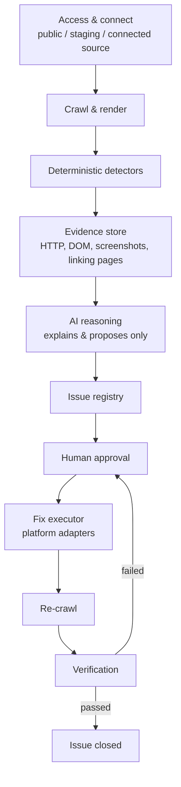

# progrowth-sitefix-agent

An internal AI-assisted agent that inspects any client website, flags
technical, SEO, and accessibility faults with evidence, and, only after
human approval, applies the fix and verifies it actually worked.

This is **not** a website builder and **not** a CMS. It is a technical QA
and error-rectification agent that sits on top of a site that already
exists.

**Status:** Phase 1, Day 6 of 12 complete. See [Current sprint](#10-current-sprint-oct-5-to-oct-17-2026).

---

## 1. Why this exists

Today, when a client site has a problem, the workflow is entirely manual:
someone inspects the site, hunts for broken pages, checks SEO and metadata
by hand, decides what to change, makes the change, and manually re-checks
that it worked. This agent is built to take over that loop (detection,
explanation, proposal, approval, execution, and verification) without
removing the human from any decision that matters.

## 2. The one rule the whole design follows

> **The AI never decides facts. It only explains and proposes.**

A crawler and a set of deterministic checks establish every raw fact (a
status code, a canonical tag, a missing title). Only after a fact exists
does the AI layer explain it in plain language and suggest a fix. The AI
never crawls, never invents a fact, never applies a fix, and never closes
an issue. A human approves every fix before it ships, and a separate
verification step, not the act of applying the fix, is what closes an
issue.

## 3. Architecture



Each stage produces a typed artifact the next stage consumes. Nothing
downstream re-derives a fact a stage above it already established, and
nothing in the pipeline can skip the human-approval step.

## 4. What Phase 1 detects

| Category | What we check for |
|---|---|
| HTTP and URLs | 404 / 410 / 5xx pages, broken links, redirect chains and loops, redirects that end in an error, HTTP/HTTPS and www mismatches |
| Soft 404s | Pages that return 200 OK but read like an error page (not-found title or H1, near-empty body) |
| SEO: titles & descriptions | Missing, duplicate, too long or too short titles and meta descriptions; missing or multiple H1; heading levels that skip; tags that only exist after JavaScript |
| SEO: indexing | Missing or duplicate canonical tag, canonical pointing to a 404 or to a redirect; pages marked `noindex` / `nofollow` (meta tag or `X-Robots-Tag` header) |
| Social sharing | No Open Graph tags, essential ones missing (title, description, image), share image that does not load |
| Page setup | No viewport tag (not mobile-friendly), no `lang` on `<html>` |
| Content | Thin pages (under 200 words), near-duplicate pages (85%+ the same text once menus and footers are removed), leftover placeholder text (lorem ipsum, unfilled `{{template}}` tags), repeated words ("the the"), spelling and grammar mistakes (quoted with a corrected version) |
| Sitemap and robots | robots.txt errors, sitemap URLs that error, redirect, or are wrongly marked noindex |
| Images | Broken images, missing / unhelpful / too-long alt text, oversized files, HTTP images on HTTPS pages |
| Links | Broken or redirected internal/external links, plus every page that links to the broken one |
| Structured data and accessibility | Invalid schema (JSON-LD), missing form labels, contrast signals |

**Why the head checks are split this way.** Almost everything in a page's
`<head>` is "metadata", so that word is not a useful group. Checks are grouped
by **who reads the tag**, because that decides the impact and who fixes it:
Google's results page (titles & descriptions), Google's crawler (indexing),
link previews on Facebook, LinkedIn, WhatsApp and X (social sharing), and
browsers, phones and screen readers (page setup). Page *text* is a fifth
group, **Content**, read by the people visiting the page. The code follows the same
split: `lib/head.js` only reads the page, and each group has its own rules
file (`lib/seo.js`, `lib/social.js`, `lib/page-setup.js`, `lib/content.js`).

Every finding carries evidence (a status code, a screenshot, or a DOM
snippet), never a guess. This list is adapted from the overlapping
categories used by established site-audit tools (Semrush, Ahrefs,
Sitebulb), consolidated into a set sized for Phase 1 rather than a full
clone of a mature enterprise crawler.

**Coverage in the current sprint (to Oct 17):** HTTP/URLs, links, redirects,
metadata, canonical tags and soft 404s are built and tested; image
checks are built and tested (broken images, alt text, mixed content, oversized files); robots.txt parsing,
structured data and accessibility follow in the next block.

## 5. How a fix is classified

| Fix category | Examples | Who decides the content | Who executes |
|---|---|---|---|
| Safe / deterministic | Redirecting a known-broken link to its one obvious replacement, removing byte-identical duplicate meta tags | A rule engine; the answer is unambiguous | Adapter, after human approval |
| AI-proposed, human-approved | Generating a meta description, choosing a redirect target among several candidates, generating alt text | AI, from evidence only | Adapter, after human approval |
| Detected, not yet automatable | Most performance and accessibility findings; any platform without a working adapter | N/A | Routed to a manual engineering ticket |
| Never autonomous | Deleting pages, changing auth, modifying databases, payment logic, DNS, destructive production changes | N/A | Never this system |

Classification goes by **what the change touches** (which file, API, or
table), not by the issue's category label alone.

## 6. Access model and platform adapters

| Level | What it is | Unlocks |
|---|---|---|
| 1: Public | The live URL, no credentials | Detection only |
| 2: Staging | Login credentials or custom headers for a gated site | Detection on pre-release environments |
| 3: Connected source | GitHub, WordPress, or Webflow access | Required before any fix can be executed |

| Platform | How we connect | How a fix lands |
|---|---|---|
| **GitHub sites (pilot)** | Scoped token or GitHub App, one repo only | Branch, patch, diff, pull request, CI, human merges |
| WordPress | REST API, scoped application password | Title/meta/alt text: direct write. Canonical: only if the site's SEO plugin exposes it for writing (Yoast's REST API is read-only by default). Redirects: need a redirect plugin or server rule |
| Webflow | CMS API; Designer API for structural fields | Content fields via CMS API. Redirects and canonical usually need a manual Designer step |
| Anything else | No adapter built yet | A fully-specified ticket a human applies by hand |

Behind the GitHub adapter, any framework in the repo rides the same
branch/PR/CI flow: Next.js, React, static HTML, PHP/Laravel, custom CMS.
The AI never holds these credentials; only the adapter layer does, and
only after a human approves. None of the adapters are built yet.

## 7. Phase boundaries

- **Phase 1 (this repo):** detect, explain, propose, get human approval,
  execute only low-risk fixes, verify. No content editing, no CMS, no
  autonomous production changes.
- **Phase 2 (later, separate effort):** an editable CMS layer for page
  content, sections and images. Deliberately kept out of Phase 1's schema
  and UI so it can be added later without a rebuild.

**Out of scope for Phase 1:** a visual CMS or content editor, publishing
new pages, autonomous or unapproved production changes, full performance
re-engineering, content strategy work, and heavy infrastructure
(multi-agent orchestration, Kubernetes) before it is needed.

## 8. Tech stack

| Layer | Tool | Status |
|---|---|---|
| Crawler and renderer | Node.js, Playwright (headless Chromium) | In use |
| Test fixture and scoring | Node.js built-ins (`http`, `fetch`) | In use |
| Unit tests | `node:test` (built in) | In use |
| CI | GitHub Actions | In use |
| Issue registry | JSON file now (`issues.json`, one run), PostgreSQL later | In use (v0) |
| Chat-first UI | Vanilla HTML, CSS and JS (no framework), Node.js HTTP + SSE server, no new dependencies | In use (Day 10) |
| AI reasoning | OpenAI API (`gpt-4o-mini` by default; any OpenAI-compatible endpoint), behind guardrails; a mock provider for tests | In use (v1: explanations, fixes, chat) |
| PDF report | Playwright's Chromium (print to PDF) | In use |
| Fix adapter | GitHub REST API | Planned |
| Secrets | GitHub Actions secrets now, a secrets manager later | Planned |
| Dashboard | React + Tailwind | Planned |

## 9. Repository layout

```
progrowth-sitefix-agent/
├── .github/
│   ├── PULL_REQUEST_TEMPLATE.md      every PR must fill this in
│   └── workflows/
│       ├── crawl.yml                  run the crawler on any URL (manual)
│       └── fixture-selfcheck.yml      unit tests, then crawl and score the fixture on every change
├── bench/                             speed benchmark
│   ├── server.js                      a 200-page site with heavy images, a web font, never-idle analytics and slow responses
│   ├── time.js                        times crawl.js step by step against any URL
│   ├── settle-diag.js                 shows what keeps changing on a page that never "settles"
│   ├── load-diag.js                   shows what a page waits for before it can be read, one page vs 8 at once
│   └── speed-diag.js                  times the phone speed test on the bench site and prints what it measured
├── fixture/                           controlled test site with planted faults
│   ├── generate-site.js               writes the 24 HTML pages and the small images into site/
│   ├── server.js                      serves them with real HTTP redirects (and generates the oversized test image)
│   ├── selfcheck.js                   proves the fixture behaves as claimed
│   ├── score.js                       scores crawler output against the planted issues
│   ├── expected-issues.json           ground truth: the 30 planted issues
│   └── site/                          generated pages
├── lib/
│   ├── redirects.js                   follow redirects hop by hop, classify them, site-level checks
│   ├── head.js                        read a page's head into facts: title, description, canonical, robots, Open Graph, viewport, lang, headings
│   ├── seo.js                         SEO rules: titles, descriptions, H1, heading order, canonical, noindex / nofollow
│   ├── social.js                      social sharing rules: Open Graph tags, broken share image
│   ├── page-setup.js                  page setup rules: viewport, lang
│   ├── soft404.js                     soft-404 rule: says "not found" plus a second signal
│   ├── copy.js                        spelling and grammar: built-in misspellings list + AI proofreading with guardrails
│   ├── content.js                     content rules: boilerplate removal, thin pages, near-duplicates (MinHash), placeholder text, repeated words
│   ├── images.js                      image rules: pick the real src, decorative or not, alt text, size, mixed content
│   ├── speed.js                       phone speed test: LCP, CLS, TBT, TTFB, page weight; which pages; ratings and issues
│   ├── queue.js                       the crawl queue, fair across the site's sections (large sites)
│   ├── input.js                       what was typed in the chat box: a site, several sites, almost an address, or a question
│   ├── issues.js                      issue schema, severity and fix-class catalog, registry builder and validator
│   ├── progress.js                    live progress lines from crawl.js / report.js to the UI: counts, steps, findings, time left
│   ├── suggest.js                     suggested questions from the kinds of problems found (the page carries a copy)
│   ├── live-answers.js                instant answers about the inspection itself: how it works, why it takes long, time left, found so far
│   ├── list-answers.js                list answers from the report ("which images are broken?", "what should I fix first?"), no AI needed
│   ├── screenshots.js                 screenshots with the problem outlined, shared by report.js and the chat (taken on demand)
│   ├── start-url.js                   follows the start address to the real site (http to https, www twin) before crawling
│   ├── throttle.js                    per-site request limits that slow down by themselves on 429 / 503
│   ├── trackers.js                    tracking, advertising and chat scripts not loaded while pages are read
│   ├── triage.js                      priority (P1/P2/P3), who fixes it, effort, quick wins
│   ├── explain-templates.js           standard plain-language guidance for every issue type (used when AI is off)
│   ├── explain.js                     AI explanations and suggested fixes, with guardrails and a cache
│   ├── chat.js                        answers questions from one report only; checks every cited issue id
│   ├── history.js                     past inspections in history/<run-id>/: save, list, open, delete
│   ├── report-html.js                 the printable report (HTML that report.js turns into the PDF)
│   ├── web-report.js                  the live web report: score, levels, coach messages, I fixed it / Check it now; also one downloadable file
│   ├── score.js                       the site score (0-100, on-page / technical / off-page), points per fix, levels
│   ├── coach.js                       the live report's messages: AI wording, checked; numbers are placeholders
│   ├── verify.js                      Check it now: the crawl's rules run again on the live site for chosen issues
│   ├── ai-provider.js                 the only code that talks to an AI: OpenAI or the mock, from .env
│   ├── ai-mock.js                     the mock AI (no key, no network) for demos, tests and CI
│   └── env.js                         reads .env without overriding real environment variables
├── test/
│   ├── redirects.test.js              unit tests for lib/redirects.js
│   ├── head.test.js                   unit tests for lib/head.js
│   ├── seo.test.js                    unit tests for lib/seo.js
│   ├── social.test.js                 unit tests for lib/social.js
│   ├── page-setup.test.js             unit tests for lib/page-setup.js
│   ├── soft404.test.js                unit tests for lib/soft404.js
│   ├── copy.test.js                   misspellings list, quote-must-exist and site-vocabulary guardrails, caching
│   ├── content.test.js                unit tests for lib/content.js
│   ├── images.test.js                 unit tests for lib/images.js
│   ├── speed.test.js                  thresholds, page sample, CLS windows, issues, summary, a real phone test, time budget
│   ├── queue.test.js                  sections in turn, every section reached on a big site, pages added while crawling
│   ├── input.test.js                  one site, several sites, almost-addresses, emails, questions, self-contained copy
│   ├── issues.test.js                 unit tests for lib/issues.js
│   ├── triage.test.js                 priority, effort, owner; every type has a rule and guidance
│   ├── explain.test.js                guardrails (invented URLs, bad ids, value lengths), fallbacks, cache
│   ├── chat.test.js                   context selection, cited-id checks, error handling
│   ├── history.test.js                save, report matching, pruning, delete stays deleted, safe file names
│   ├── ai-provider.test.js            .env loading, config, OpenAI request format and retries (fake server)
│   ├── report-html.test.js            report sections, escaping, screenshots, caps
│   ├── live-answers.test.js           which questions are answered at once, the live numbers in them, self-contained copy
│   ├── suggest.test.js                question order, no repeats, every issue type covered, self-contained copy
│   ├── list-answers.test.js           topics in many wordings, order, limits, AI not asked, every suggestion answered
│   ├── screenshots.test.js            what is shown and outlined, which issues get a screenshot, a real capture
│   ├── start-url.test.js              same-site redirects followed; other sites, loops and errors left alone
│   ├── progress.test.js               progress messages, finding counts and cap, time-left estimate, line parsing
│   ├── trackers.test.js               the trackers seen on progrowth.services are matched; site scripts, forms, maps never are
│   ├── throttle.test.js               per-site limits, backing off on 429 / 503, Retry-After, the check pool
│   └── web-report.test.js             filter data, escaping, no network in the downloaded file, fix-first order (npm test runs them all)
├── ui/                                chat-first internal website audit agent UI
│   ├── build-index.js                 source of the page: edit this, then run it to regenerate index.html
│   ├── index.html                     generated single-page chat interface (do not edit by hand)
│   └── server.js                      Node.js HTTP server: runs crawl.js then report.js, streams both over SSE, serves the PDF and the chat
├── crawl.js                           the crawler (page crawl, link checks, redirect, metadata and soft-404 analysis, then builds the issue registry)
├── report.js                        after a crawl: triage, explanations, screenshots, then audit-report/ (JSON, PDF, web-report.html)
├── .env.example                     template for .env (your API key; .env itself is never committed)
├── package.json
├── .gitignore
└── README.md
```

## 10. Current sprint: Oct 5 to Oct 17, 2026

Goal: turn the Week 1 crawler into a tested detection engine that records
every finding with evidence in an issue registry, with an AI layer that
explains each finding from that evidence only. 12 working days, Monday to
Saturday. Fridays are a half day of build plus review preparation.

| Day | Date | Aim | Status |
|---|---|---|---|
| 1 | Mon Oct 5 | Test fixture with planted faults and ground truth | **Done** |
| 2 | Tue Oct 6 | Crawl coverage: configurable page cap, check every link directly, found-on map | **Done** |
| 3 | Wed Oct 7 | HTTP and redirect detector | **Done** |
| 4 | Thu Oct 8 | Metadata and canonical detector | **Done** |
| 5 | Fri Oct 9 | Soft-404 rule, then Week 1 review prep | **Done** |
| 6 | Sat Oct 10 | Evidence capture and issue schema, registry v0 | **Done** |
| 7 | Mon Oct 12 | Registry across runs, image and sitemap checks | Image checks **Done**; registry across runs and sitemap checks planned |
| 8 | Tue Oct 13 | AI layer: input and output contract | **Done** (explanations, fixes, chat) |
| 9 | Wed Oct 14 | AI layer: guardrails and evaluation | **Done** (guardrails, fixture run with mock AI in CI) |
| 10 | Thu Oct 15 | Readable report: chat-first audit UI (SiteFix) | **Done** |
| 11 | Fri Oct 16 | Live-site runs (faster full-site crawl), then Week 2 review prep | In progress |
| 12 | Sat Oct 17 | Validation and close-out | Planned |

Beyond this sprint, the Phase 1 plan continues with the approval queue,
the GitHub adapter and the verification engine (re-crawl, then close or
reopen), which together complete the detect-to-verify loop end to end.

## 11. Getting started

Requirements: Node.js 22 or newer, Git.

```bash
git clone https://github.com/indhuja-elumalai/progrowth-sitefix-agent.git
cd progrowth-sitefix-agent
npm install
npx playwright install chromium
```

### Run the chat-first UI (SiteFix)

A chat-style front end for the crawler: paste a URL, watch the crawl stream
in, then read the findings from `issues.json` as grouped, expandable cards.

```bash
npm run ui                        # http://localhost:3000
node ui/server.js --port 3001     # any other port
```

The UI runs the crawler with no page cap, so a large site takes a while;
the log shows how many pages are still queued.

To try it on the fixture, start `node fixture/server.js` in a second
terminal, then click the `localhost:4000` chip under the input box.

What you get:

1. **One input.** The URL box is focused on load. Press Enter (or the round arrow button)
   to send; the box clears like a sent message. Bare domains get `https://` added (`http://` for localhost).
2. **Live progress.** A progress card shows the real numbers as the inspection
   runs: a progress bar, pages done out of pages found (or the sitemap size,
   whichever is larger), links and images checked, an estimate of the time
   left (from the pages per second over the last 30 seconds), the time so far,
   and the step it is on (Pages, Links & images, SEO & content, Spelling,
   Explanations & screenshots, Reports). Below it, problems appear the moment
   they are found (broken links and images, redirect loops, missing titles,
   noindex...), with a running count by severity; the final list replaces the
   count at the end. "Show details" opens the raw log. The browser tab shows
   the percentage, and "Report ready" when it finishes in the background.
   Past inspections can be opened while one runs: it stays at the top of the
   list under "Now" with its percentage, and one click brings it back. A page
   reload during an inspection picks it up again.
   Under the card, suggested questions change with what is being found (a
   broken image brings "Which images are broken?"). A question picked or typed
   during the inspection is queued and answered by AI as soon as the report is
   ready, then saved with the inspection. Finished inspections show
   suggestions too, based on what they found, leaving out questions already
   asked.
3. **Summary card.** Start URL, pages crawled, time taken, whether the page
   cap was hit, and counts by severity.
4. **Issue cards grouped by category.** Each shows the issue type, severity,
   affected URL, detail and fix class. Click a card to see its evidence
   (HTTP status, redirect chain, head tags, soft-404 signals) and the pages
   that link to it (`foundOn`, first five).
5. **Explanations, priorities and fixes.** After the crawl, `report.js` runs
   automatically. Categories start collapsed; open one to see its issues,
   sorted P1 first. Each issue shows its priority, effort, who fixes it and
   whether it is a quick win, and its evidence opens with: in plain words,
   why it matters, how to fix, a suggested value (title, description or alt
   text) with a Copy button, and a screenshot.
6. **PDF report.** "Open PDF report" on the summary card opens the full
   report: a cover with totals and what to fix first, then one section per
   issue type with the explanation, fix steps, every instance and screenshots
   (the broken link or image outlined in red).
7. **Chat about the report.** Type a question in the same box ("what should I
   fix first?", "which images are broken?", "what is wrong with the austin
   page?"). Answers use only this inspection's data, cite the issues they
   used (click a citation to open that issue), and say so when the report
   does not cover something. A URL in the box still starts a new inspection.
8. **Web report.** "Open web report" on the summary card opens the report as a
   web page (`/report/<inspection>`): totals you can click to filter, "Fix these
   first", issues by category, then every issue with a search box and filters
   for priority, category, who fixes it and quick wins. Each issue opens to
   show the explanation, why it matters, fix steps, a suggested value with a
   Copy button, the evidence, the pages it is on and a screenshot. "Download"
   saves the same page as one HTML file with the screenshots built in: it
   opens in any browser without SiteFix running and loads nothing from the
   internet, so it can be emailed or uploaded as it is. It follows the
   reader's light or dark setting and prints cleanly. `node report.js` also
   writes it to `audit-report/web-report.html`.
9. **Past inspections.** Every finished inspection is listed in the sidebar
   (Today, Yesterday, then by date) with its time, issue count and pages.
   Click one to reopen it with its PDF, screenshots and the questions you
   asked about it. The list and the open inspection survive a page reload
   and a server restart. Hover an inspection and click the bin to delete
   it (click again to confirm); "Delete all" clears the list. On a phone,
   the menu button at the top left opens the list.

History is kept on disk in `history/<run-id>/` (ignored by git): the issue
registry, the explained report, the PDF, the screenshots and the chat. The
newest 50 are kept (`SITEFIX_HISTORY_MAX` changes that). Crawls run from the
terminal (`node crawl.js` then `node report.js`) are added the next time the
UI loads the list. A deleted inspection is remembered in
`history/deleted.json`, so it is not added back from the files in the
project root.

Guardrails in `ui/server.js`: it listens on `127.0.0.1` only (set
`SITEFIX_UI_HOST` to change that), runs one inspection at a time (every run
writes `issues.json` in the project root), and only returns results for a
run that exited cleanly, so a failed crawl never shows the previous site's
issues. History ids must look like `run-YYYYMMDDTHHMMSS` and only
`report.pdf` and `shots/ISS-xxxxxxxxxx.jpg` can be read from an inspection
folder, so no request can reach other files. Deleting needs `DELETE`, which
the server never allows from another website (its CORS preflight allows
only GET and POST).

To change the page, edit `ui/build-index.js` and run
`node ui/build-index.js` to regenerate `ui/index.html`. Commit both.

### AI layer: set up your API key

The AI explains each issue in plain language, writes the fix and suggested
values, and answers chat questions. Without a key everything still works with
SiteFix's standard guidance, except the chat.

```bash
cp .env.example .env        # .env is in .gitignore: it is never committed
open -e .env                # or any editor; set OPENAI_API_KEY=sk-...
npm run ui                  # the server prints "AI: openai (gpt-4o-mini)" when the key is picked up
```

Settings in `.env`: `OPENAI_API_KEY` (required for AI), `AI_MODEL` (default
`gpt-4o-mini`; any chat model on your account), `AI_PROVIDER` (`openai`,
`mock` or `none`), `AI_BASE_URL` (any OpenAI-compatible endpoint),
`SITEFIX_ALLOW_WORDS` (comma-separated words the spelling check must never flag,
such as brand or product names). A real
environment variable always wins over `.env`. Restart the UI server after
changing `.env`. For the GitHub Action, add the key as a repository secret
named `OPENAI_API_KEY`.

`AI_PROVIDER=mock` runs the whole pipeline with no key and no cost (fixed,
evidence-based answers); CI uses it on every push.

How it stays real (`lib/explain.js`, `lib/chat.js`):

- One AI call per issue **type** (up to 8 instances each), so 300 redirect
  chains cost one call, not 300. Answers are cached in
  `.sitefix-ai-cache.json`, so re-running a report costs nothing.
- The AI sees only the issue's own evidence, never the raw page.
- Every answer is checked: valid JSON in the expected shape, length limits,
  **every URL it mentions must appear in the evidence**, issue ids must be
  real, suggested values must fit the rules (title 10-60 characters,
  description 50-160, alt text up to 125). Whatever fails a check is replaced
  by the standard guidance and the reason is logged.
- Chat answers come from this report only; issue ids not in the report are
  removed from the answer.
- Priority and effort are rule-based (`lib/triage.js`), not AI: the same issue
  always gets the same priority.

Run the report on its own after a crawl:

```bash
node report.js                       # AI if a key is set, else standard guidance
node report.js --no-ai               # standard guidance only
node report.js --no-screenshots      # faster, no screenshots
node report.js --max-screenshots 10  # default 30
```

It writes `audit-report/explained.json` (every issue with priority, effort,
owner, explanation, fix and suggested value), `audit-report/report.html`,
`audit-report/sitefix-report.pdf` and `audit-report/shots/`.

### Run the crawler via CLI

```bash
node crawl.js https://your-site.com            # whole site, no page cap
node crawl.js https://your-site.com --max-pages 50   # quick partial run
node crawl.js https://your-site.com --speed-pages 0  # phone speed test on every page (default: 40)
node crawl.js https://your-site.com --no-speed       # skip the speed test
node crawl.js https://your-site.com --speed-seconds 30 # stop starting speed tests after 30 s (default: no limit; the chat UI uses 30)
node crawl.js https://your-site.com --time-budget 45 # stop reading new pages after 45 s (large sites; the chat UI uses 45)
```

By default it crawls every internal page it can reach: everything linked
from the start page onwards, plus every URL in the site's sitemap
(`Sitemap:` lines in `robots.txt`, else `/sitemap.xml`, following sitemap
index files). Tracking parameters (`utm_*`, `gclid`, `fbclid`, ...) are
ignored when deciding whether a page was already crawled.

| Option | Default | What it does |
|---|---|---|
| `--max-pages N` | `0` (no cap) | Stop after N pages |
| `--concurrency N` | `8` | Pages rendered in the browser at the same time |
| `--link-concurrency N` | `16` | Link and image checks at the same time (all sites together) |
| `--per-host N` | `6` | Link and image checks at the same time to any one site |
| `--settle-ms N` | `1500` | Longest wait for late JavaScript after a page loads |
| `--quiet-ms N` | `400` | A page is read once it has loaded and its content has not changed for this long |
| `--delay-ms N` | `0` | Smallest pause between requests to the same site (it grows by itself when a site answers 429 or 503) |
| `--keep-trackers` | off | Also load tracking, advertising and chat scripts while reading pages (skipped by default; they never change what is checked) |
| `--block "pattern,..."` | none | More URL patterns not to load while reading pages, e.g. `"*widget.example.com/*"` |
| `--full-render` | off | Also download images, video and fonts while rendering, and wait for the network to go quiet (the old, slower behaviour) |
| `--no-sitemap` | off | Only follow links, skip the sitemap |
| `--no-ai` | off | Spelling check uses the built-in misspellings list only (no AI proofreading) |
| `--copy-ai` | off | Run AI proofreading on a local address too (it is skipped there by default) |

The crawl is fast by default and polite on its own: when a site answers 429
("too many requests") or 503, the pause before its next request doubles
(respecting the site's `Retry-After`), and a refused page is tried again up to
3 times. For a small or fragile server you can still go gentler, for example
`--concurrency 2 --per-host 2 --delay-ms 300`. `links.json` records how long
each step took (`summary.seconds`) and how often a site asked to slow down
(`summary.slowDowns`). It writes seven files:

- `report.json`: one entry per crawled page (raw vs rendered status, title,
  word count, broken resources, and the page's title, meta description, H1s,
  canonical and robots tags as read from both the raw and the rendered HTML).
- `links.json`: a summary, the site-level checks, the most common redirect
  destinations, and one entry per distinct link found, each checked directly
  (HEAD, falling back to GET on 403/405/501, redirects not followed). Every
  link lists the pages it was **found on** and is classed `ok`, `redirect`,
  `broken` (4xx/5xx), `unverified` (timeout, or blocked with 401/403/429/999)
  or `unreachable` (network error). Every redirecting link is followed hop by
  hop (up to 10) and typed as a `redirect-loop`, a `redirect-chain` (2 or more
  hops) or a `redirect-to-error`; a single redirect to a working page is
  recorded but not reported as an issue.
- `metadata.json`: for every page that loads (2xx), everything read from its
  head (title, description, H1s and heading outline, canonical, robots, Open
  Graph and Twitter tags, viewport, lang) and every SEO, social sharing and
  page setup issue found on it, each with a type, a severity and a one-line
  detail; a summary count per category and per type; and every distinct share
  image (`og:image`) with its HTTP check. The rules run on the **rendered** page (what a
  browser and Google end up with); `metadata-js-only` marks a title,
  description, H1 or canonical that is missing from the raw HTML and only
  appears after JavaScript runs.

- `issues.json`: **the issue registry**, and the file everything downstream reads.
  Every finding from every detector as one typed record, plus the run it came
  from and counts by severity and type (see [Issue records](#issue-records)).
- `soft404.json`: every page that shows at least one soft-404 signal, with the
  evidence and a `flagged` true/false. Candidates are every page that loaded
  plus up to 20 pages that are only ever reached through redirects (the
  crawler never lands on them directly).
- `content.json`: a summary (pages analysed, menu / footer lines ignored,
  thin, near-duplicate, placeholder, repeated-word counts) and, per page, its
  word count, its own word count once menus and footers are removed, its
  content issues and the pages it is near-identical to. The page text itself
  is not saved.
- `images.json`: a summary (images found, broken, alt problems, mixed
  content, oversized, size unknown) and one entry per distinct image URL:
  its status, where it redirects, its size and type, every page it is on,
  and which pages have missing, unhelpful or too-long alt text. Each image
  is checked once (HEAD, falling back to GET; redirects followed to the
  real file). Decorative images (`alt=""`, `role="presentation"`,
  `aria-hidden="true"`) skip the alt rules. Lazy-loaded images are read
  from `data-src` / `srcset` when `src` is only a placeholder. Limits:
  alt text up to 125 characters, files up to 300 KB (`IMAGE_LIMITS` in
  `lib/images.js`).
- `speed.json`: the phone speed test (lib/speed.js). A summary (pages
  tested, medians, how many pages are good / need work / poor on each
  measure, how many pass Core Web Vitals, the slowest pages) and one entry
  per page tested: LCP, CLS, TBT, TTFB, FCP, load time, page weight and
  files, what the main content is, which elements moved, and the largest
  files.

### Issue records

Each entry in `issues.json` is a measured fact, never AI output:

| Field | Meaning |
|---|---|
| `id` | Stable: the same type on the same URL always gets the same id (`ISS-` plus 10 hex characters), so a later run can recognise it |
| `type`, `category` | e.g. `canonical-broken-target`, "SEO: indexing" |
| `severity` | `high`, `medium` or `low`, from a catalog in `lib/issues.js` (a rule may override it) |
| `affectedUrl`, `foundOn` | The URL with the problem, and every page that links to it or, for page-level issues, the pages that lead to it |
| `detail` | One plain sentence stating the fact |
| `evidence` | The raw facts behind it: the HTTP status, the whole redirect chain, the page's title / description / H1 / canonical as read from the HTML (and the raw version if JavaScript changed it), the canonical's target status, or the soft-404 signals |
| `fixClass` | `deterministic`, `ai-proposed` or `not-automatable`: how a fix would be handled, never whether it needs approval (every fix does) |
| `status` | `open` for now; later days add acknowledged, fixed, verified and reopened |
| `firstSeenRun`, `lastSeenRun` | Run ids; in v0 both are the current run |

Every issue is validated when it is written, and `fixture/score.js` fails if any
issue is malformed. A type that is not in the catalog is refused, not guessed.

**Soft-404 rule:** a page that answers 200 is flagged only when it says it is an
error page (a not-found phrase or "404" in the title or H1) **and** at least
one other signal agrees: under 150 words, no H1, `noindex`, or 2 or more links
redirect into it. Title and H1 together count as one piece of evidence, and
supporting signals alone never flag a page, so an article about 404 errors or a
short valid page is left alone.

**SEO: titles & descriptions and SEO: indexing rules** (`lib/seo.js`): `title-missing`, `title-multiple`, `title-too-long` (over 60
characters), `title-too-short` (under 10), `description-missing`,
`description-multiple`, `description-too-long` (over 160), `description-too-short`
(under 50), `h1-missing`, `h1-multiple`, `canonical-missing`, `canonical-multiple`,
`canonical-broken-target` (the canonical URL returns 4xx/5xx or cannot be
reached), `canonical-redirect`, `title-duplicate`, `description-duplicate` and
`metadata-js-only`. The length limits are common SEO guidance, not facts about
any one site; they live in one place (`LIMITS` in `lib/seo.js`) and are
severity `low`. A page whose canonical points to a different URL is treated as
a declared copy and is left out of the duplicate checks.

Also in `lib/seo.js`: `heading-skip` (a heading goes more than one level
deeper than the one before, e.g. H2 then H4; going back up is fine; low),
`robots-noindex` (medium) and `robots-nofollow` (low), read from the robots
meta tag and the `X-Robots-Tag` header, including crawler-specific values
like `googlebot: noindex`. noindex is often deliberate (thank-you pages,
internal search), so these are detected only and a human decides.

**Social sharing rules** (`lib/social.js`): `og-missing` (no Open Graph tags
at all), `og-incomplete` (some, but `og:title`, `og:description` or
`og:image` missing) and `og-image-broken` (the share image returns 4xx/5xx;
each distinct image is checked once). Twitter/X falls back to Open Graph, so
`twitter:*` tags are shown in the evidence but not required.

**Page setup rules** (`lib/page-setup.js`): `viewport-missing` (medium) and
`lang-missing` (low).

**Content rules** (`lib/content.js`) read the page's visible text, line by
line, as a visitor sees it. A line that appears on at least half the pages
(menus, footers, shared blocks; only on sites with 4 or more pages) is treated
as boilerplate. `content-thin` (low): under 200 words of visible text; pages
already flagged as a soft 404 are skipped. `content-duplicate` (medium): two
pages whose own text (boilerplate removed, at least 50 words) shares 85% or
more of its 5-word phrases; candidates are found with MinHash so large sites
are not compared page by page, then confirmed with the exact score.
`content-placeholder` (high): lorem ipsum, unfilled template tags (`{{ }}`,
``, `${}`), fill-in brackets (`[insert ...]`), "your text here", sample
text, "page under construction", `TODO:` notes, and script output bugs
(`[object Object]`, `$NaN`, a line that is just "undefined").
`content-repeated-word` (low): the same word twice in a row, except words
that are legitimately doubled ("had had", "that that") and capitalised place
names ("Walla Walla"). Phase 1 does not edit page copy, so all four are
detected only.

Two site-level checks run on the start URL's host (skipped for localhost):
the `http://` version should redirect to `https://`, and the `www` / non-`www`
twin should redirect to the main host rather than serve the site itself.

It only reads; it never writes to the site.

Or run it with no local setup: GitHub, **Actions**, **Run Crawler**,
**Run workflow**, choose the branch, enter a URL and a `max_pages` value
(the workflow must exist on `main` to appear in that list).

**Known limits of the current crawler:** only `<a href>` links in the
rendered page are checked (not images, scripts or links added after user
interaction); query-string variants of a page are crawled as separate pages;
a link check that times out is reported as `unverified` without a second
attempt (two sonagroup.ae pages timed out at 10 s although `curl` shows them
answering in about 2 s); the soft-404 rule needs the page to say it is an error, so a soft 404 with a
normal title and content is not caught; metadata rules only judge pages the crawler visited
(so a capped crawl does not check every page); a canonical that points to a
redirecting URL is flagged but its final destination is not followed; and there
is no sitemap or image detection yet. Evidence is structured facts only; screenshots
and raw DOM snippets are not captured yet. The registry is one run's snapshot:
it does not yet compare with earlier runs.

### Run the unit tests and the test fixture

```bash
npm test                              # unit tests for every rule file and the registry (no server needed)
```

The fixture is a small site with a known set of planted faults, used to
measure whether each detector finds everything and nothing extra.

```bash
node fixture/generate-site.js         # write the pages (re-run after editing the generator)
node fixture/server.js                # terminal 1: site on :4000, "external" site on :4001
node fixture/selfcheck.js             # terminal 2: expects "All checks passed."
node crawl.js http://localhost:4000   # crawl the fixture
node fixture/score.js                 # compare the crawl with the answer key
```

It uses a local Node server rather than GitHub Pages because Pages cannot
serve real HTTP 301/302 redirects, so a redirect chain or loop cannot be
planted there. The same server runs in CI (`fixture-selfcheck.yml`), which
runs the unit tests, then crawls and scores the fixture on every push.

**Detected so far: all 30 planted issues, with 0 false positives** (CI
requires 30).

**The 30 planted issues** (`fixture/expected-issues.json`):

| ID | Planted fault |
|---|---|
| F-01 | Internal link returns 404 |
| F-02 | External link returns 404 |
| F-03 | Broken image (404) |
| F-04 | Redirect chain, 3 hops |
| F-05 | Redirect loop |
| F-06 | Soft 404 (200 OK, not-found title and H1, short body) |
| F-07 | Missing title |
| F-08, F-09 | Duplicate title (one entry per page) |
| F-10 | Canonical pointing at a 404 |
| F-11 | Redirect that ends in a 404 (`/old-page`) |
| F-12 | Soft 404 reached only through redirects: 200 OK, title says 404, two old links redirect into it (the sonagroup.ae pattern) |
| F-13 | Image with no alt attribute (`/img/office.svg` on `/image-alt.html`) |
| F-14 | Image whose alt text is a camera file name (`IMG_0042.jpg`) |
| F-15 | Image with alt text over 125 characters |
| F-16 | Image file over 300 KB (`/img/large-banner.svg` on `/large-image.html`, generated by the server) |
| F-17, F-18 | Page marked `noindex, nofollow` (`/noindex.html`) |
| F-19 | Heading levels skip, H2 then H4 (`/heading-skip.html`) |
| F-20 | No Open Graph tags (`/no-social.html`) |
| F-21 | Open Graph tags without `og:description` (`/social-partial.html`) |
| F-22 | Share image (`og:image`) that returns 404 |
| F-23, F-24 | No viewport tag and no `lang` (`/page-setup.html`) |
| F-25 | Thin page: `/contact.html`, 15 words (it is still the soft-404 negative control) |
| F-26, F-27 | Near-duplicate pages: `/location-austin.html` and `/location-denver.html`, one template with the city swapped |
| F-28 | Placeholder text: lorem ipsum and `{{ company_name }}` (`/draft-page.html`) |
| F-29 | Repeated word: "the the" (`/draft-page.html`) |
| F-30 | Spelling: "recieve" and "seperate" (`/typos-page.html`), caught by the built-in list |

Three control pages (`/`, `/about.html`, `/final.html`) must produce no
issues, and the self-check confirms every fixture title and description is
inside the length limits so the length rules stay quiet, and that every page
except the planted short ones has at least 200 words. `/contact.html` is
deliberately short but valid: it must be reported as thin (F-25) and never as
a soft 404. The shared filler paragraph on most pages doubles as a
boilerplate test: it must be ignored when pages are compared for
near-duplicates. `/image-alt.html` also carries two
decorative images (`alt=""` and `aria-hidden="true"`) that must not be
flagged. Not yet planted: http-to-https and www mismatches (they need real
hostnames, so they are covered by unit tests with a fake server), image mixed
content (the fixture runs on http, so it is covered by unit tests), and
sitemap and robots faults.

## 12. Results so far

### Week 1: crawler tested on two live sites

| Site | Finding |
|---|---|
| progrowth.services | Two crawler bugs: `&amp;` in titles read as a JavaScript change, and `/industries/` pages failing to render because they never reach network-idle. Both fixed (entity decoding; wait for `domcontentloaded`). |
| sonagroup.ae | Fixes confirmed on a second site. Found 5 real broken product thumbnails across 4 pages, all under `/public/products-images/thumb-image/`. |

### Day 1: baseline of the Week 1 crawler on the fixture

| Planted issue | What the crawler shows today |
|---|---|
| F-01 internal 404 | Visible (page entry with status 404), not labelled |
| F-02 external 404 | Missed |
| F-03 broken image | Visible (`404 /img/missing.jpg`), not labelled |
| F-04 redirect chain | Visible as a bare 301, hops not counted |
| F-05 redirect loop | Visible as a null render status, not labelled |
| F-06 soft 404 | Missed |
| F-07 missing title | Missed (a false `jsChangedTitle` flag appears instead) |
| F-08, F-09 duplicate titles | Missed |
| F-10 canonical to 404 | Missed |

**4 of 10 have a visible signal, 0 of 10 are labelled as issues, 6 are
missed.** `jsChangedTitle` also gave 4 false flags. Days 2 to 5 close
these gaps; every detector is measured against `expected-issues.json`.

### Day 2: crawl coverage

Page cap replaced by `--max-pages`; every link is now checked directly with
found-on pages. On the fixture the score went from 0 to **2 of 10 planted
issues found** (F-01 internal 404, F-02 external 404, both with the correct
found-on page) with **0 false positives**.

Real-site check (sonagroup.ae, 40 pages crawled with 4,290 still queued, mostly
`products.html` filter variants; 689 links checked): 0 broken, 97 redirecting.
Of the redirects, 9 internal links redirect to `/404.html`, which returns 200
with the title "404" and no H1 (a verified soft 404; `/faqs.html` alone is
linked from every crawled page), 85 are `products.html/?...` filter links that
301 because of a trailing slash, and 3 brand links redirect to the generic
products page. The homepage rejects HEAD requests with 403, so link checks now
retry with GET before judging.

### Day 3: redirect detector

Redirects are followed hop by hop and classified (loop, chain, ends in an
error); the http-to-https and www / non-www checks are in place and
unit-tested (13 tests). The fixture gained a planted fault, F-11 (a redirect
to a 404), and the score went from 2 to **5 of 11 planted issues found**
with **0 false positives** (F-04 chain, F-05 loop and F-11 redirect-to-error
added to F-01 and F-02). `jsChangedTitle` now only compares real pages: 4
false flags on the fixture became 0.

Real-site check (sonagroup.ae, 40 pages, 689 links): 590 ok, 0 broken, 97
redirecting, 2 unverified. All 97 redirects are single-hop: 0 loops, 0 chains,
0 ending in an error. 9 end at `/404.html` and 3 at the generic products page;
because `/404.html` returns 200, the redirect detector does not report them as
an issue, and they appear under "most common redirect destinations" for the
Day 5 soft-404 rule to flag. Site-level checks (http to https, www / non-www)
found nothing; `curl` shows `http://www.sonagroup.ae/` and
`https://sonagroup.ae/` both answering 301. The 2 unverified links were
10-second timeouts on pages that `curl` shows answering 200 in about 2 seconds,
so they are not broken.

### Day 4: metadata and canonical detector

Each page's title, meta description, H1s, canonical and robots tags are read
from both the raw HTML and the rendered page. Rules cover missing, empty,
multiple, too-long and too-short titles and descriptions, missing or multiple
H1s, missing or conflicting canonicals, canonicals that point at an error or a
redirect, duplicate titles and descriptions across pages, and tags that only
exist after JavaScript runs (20 new unit tests, 33 in total). On the fixture
the score went from 5 to **9 of 11 planted issues found** (F-07 missing title,
F-08 and F-09 duplicate title, F-10 canonical to a 404) with **0 false
positives**, and the CI gate was raised from 5 to 9. Only F-03 (image, Day 7)
and F-06 (soft 404, Day 5) are still missed. A throwaway page that injects its
title, description and canonical with JavaScript was correctly reported as
`metadata-js-only`.

### Day 5: soft-404 rule

A page that answers 200 but says "not found" is flagged when a second signal
agrees (almost no text, no H1, `noindex`, or several links redirecting into
it). Pages reached only through redirects are fetched and judged too, because
that is how sonagroup.ae's `/404.html` stays hidden: the crawler never lands on
it directly. The fixture gained F-12, a page modelled on that case (13 pages
now), and 9 new unit tests bring the total to 42. The score went from 9 to
**11 of 12 planted issues found** with **0 false positives**, and the CI gate
was raised from 9 to 11. Only F-03 (image, Day 7) is still missed.

### Day 6: evidence and issue registry v0

Everything the detectors find now lands in one registry, `issues.json`: a typed
record per issue with severity, fix class, the pages it was found on and the
evidence behind it (13 new unit tests, 55 in total). `fixture/score.js` now
reads only the registry, so the same 11 of 12 planted issues found with 0 false
positives also proves the registry carries every detector's output, and the
score fails if any issue is malformed. The CI gate stays at 11.
Real-site check (sonagroup.ae, 40 pages crawled): the registry holds 97 issues,
all valid against the schema (1 high, 40 medium, 56 low). They are the one soft
404 (`/404.html`, reached only through redirects), 40 missing canonical tags,
39 meta descriptions under 50 characters, 14 titles under 10 characters, one
over-long title, one over-long description and one page with two H1 tags.
No broken links, loops or chains. The 97 redirects are all single hops and are
not issues.

### Day 10: chat-first internal audit UI (SiteFix)

Added `ui/`: a chat-style page and a small Node server (built-ins only, no
new dependencies). The server runs `crawl.js` as a child process and streams
its output to the page over SSE. When the run ends, the page reads
`issues.json` (schema v0) and renders it as is: no invented severities or
facts. Checked end to end against the fixture: all five detector stages
complete and the 11 issues in the registry render with their evidence.

Not built yet: filtering by severity or category, a raw JSON view, and
history that survives a page reload.

### Day 11: faster crawl, whole site covered

The crawler was spending most of its time waiting. It handled one page at a
time, waited up to 5 seconds on every page for the network to go quiet (sites
with analytics never do), opened a fresh browser context per page, and checked
links one by one. It now renders 4 pages at a time in one shared context,
waits at most 1.5 seconds for late JavaScript, and checks links and follows
redirects 8 at a time (still pausing 150 ms per request). The page cap is gone
by default, and the site's sitemap seeds the queue so pages nothing links to
are still checked.

Fixture: same 18 pages and same 11 issues as before (11 of 12 planted, 0 false
positives), 15.7 s down to 5.7 s.

Real-site check (progrowth.services, run on Oct 17):

| | Before (Day 10) | After (Day 11) |
|---|---|---|
| Pages crawled | 40 (cap hit, 176 still queued) | 171 (whole site, 0 queued) |
| Time | 8 min 33 s | 3 min 6 s |
| Time per page | 12.8 s | 1.1 s |
| Links checked | 169 | 265 |

Sitemap: 121 URLs listed, all reachable through links as well (no orphan
pages). The registry holds 36 issues (3 high, 7 medium, 26 low), mostly
redirect chains (22), plus 4 external links returning 4xx, 4 over-long titles,
2 redirects that end in an error, 2 duplicate descriptions, 1 broken internal
link and 1 missing canonical.

### Day 12: image checks

New detector `lib/images.js` (pure functions, 21 unit tests, plus 2 registry tests) and six issue
types in a new **Images** category:

| Type | Severity | Rule |
|---|---|---|
| `image-broken` | high | Image URL returns 4xx/5xx after redirects, or loops |
| `image-alt-missing` | medium | No `alt` attribute and not marked decorative |
| `image-alt-unhelpful` | low | Alt is a file name, camera name, hash or filler word ("image", "logo") |
| `image-alt-too-long` | low | Alt text over 125 characters |
| `image-mixed-content` | high | `http://` image on an `https://` page |
| `image-oversized` | medium | File over 300 KB (from the server's reported size) |

Each issue is filed once per image URL with the pages it appears on; an alt
problem lists only the pages where that image has the problem. The UI shows
an Images group with a preview, status, size, type and the alt text in the
evidence.

Fixture: score went from 11 of 12 to **16 of 16 planted issues found**, 0
false positives (F-03 broken image, plus new F-13 to F-16). Also checked by
hand against a throwaway server: an image that redirects is followed to the
real file and sized there, a lazy-loaded image (`data:` placeholder plus
`data-src`) is found, and an image redirect loop is reported as broken.

Not covered yet: CSS background images, real compression analysis (only the
reported file size), and whether the alt text actually describes the image
(that needs the AI layer).

### Day 13: SEO split by who reads the tag, plus social sharing and page setup

Reorganised the head checks so they are no longer one "metadata" bucket.
`lib/metadata.js` became `lib/head.js` (reading the page) and `lib/seo.js`
(SEO rules), with git history kept. The two existing categories were renamed
to **SEO: titles & descriptions** and **SEO: indexing**, and two new ones
added: **Social sharing** and **Page setup**. Issue ids are built from the
type and URL, so existing issues keep their ids.

Eight new issue types: `heading-skip`, `robots-noindex`, `robots-nofollow`,
`og-missing`, `og-incomplete`, `og-image-broken`, `viewport-missing` and
`lang-missing`. Every fixture page now carries complete Open Graph tags, so
only the planted pages are flagged. The UI shows one group per category, and
each issue's evidence shows only the tags that matter for it (the Open Graph
tags for a social issue, the heading outline for a skip).

Fixture: score went from 16 of 16 to **24 of 24 planted issues found**, 0
false positives. Unit tests: 78 to 101.

Not covered yet: structured data (JSON-LD), `hreflang`, Twitter-specific
tags, and whether titles and descriptions are well written (the AI layer).

### Day 14: content checks

New detector `lib/content.js` (pure functions, 15 unit tests, plus 1 registry test) and a new
**Content** category with four issue types: `content-thin`,
`content-duplicate`, `content-placeholder` and `content-repeated-word`. The
crawler now keeps each page's visible text in memory (capped at 200,000
characters per page, never written to disk) and writes `content.json`.

Two things the fixture caught while building it: a per-line cap of 1,000
characters cut long paragraphs short and undercounted words (raised, and
replaced by a per-page cap), and a shared paragraph that each page extended
with its own sentence made every page a near-duplicate, which is correct
behaviour for such a site, so the fixture now keeps its shared text in its own
paragraph like a real footer.

Fixture: score went from 24 of 24 to **29 of 29 planted issues found**, 0
false positives. Unit tests: 101 to 117.

Not covered yet: spelling and grammar (needs the AI layer or a dictionary),
readability scores, and duplicates of text on *other* sites.

### Day 15: AI layer, priorities, PDF report and chat

Every issue now gets a priority (P1 fix first, P2 fix soon, P3 when you can:
severity, raised when the issue reaches 10+ pages or the home page), an
effort (easy / medium / hard), who fixes it (developer, content writer, SEO)
and a quick-win flag, all rule-based. Every issue type has standard
plain-language guidance, and the AI (OpenAI, with guardrails) makes it
specific to each issue and writes suggested values. `report.js` adds
screenshots and a PDF. The UI collapses categories by default, shows the
explanation, fix and screenshot in each issue, links the PDF, and answers
questions about the report.

Tested without a live key: 42 new unit tests (159 in total) including a fake
OpenAI server (request format, retries, error messages) and every guardrail
(an invented URL, unknown ids, values outside the length rules, a failing
AI), plus the full fixture run with the mock AI: 29 issues, 9 P1, 10 P2, 10
P3, 12 quick wins, 24 screenshots, a 29-page PDF in about 6 seconds. CI builds
the PDF with the mock AI on every push.

Not covered yet: spelling and grammar (next branch, on this AI layer),
history of past inspections in the UI, and AI review of screenshots.

### Day 16: spelling and grammar

New `lib/copy.js` and two issue types in the **Content** category:
`copy-spelling` (medium) and `copy-grammar` (low). Each issue lists every
mistake on the page as the exact phrase and a corrected version, with a
one-line explanation; the UI shows them as "before → after" and the PDF lists
the corrections.

Two layers. A built-in list of 115 common misspellings ("recieve",
"seperate", "occured") always runs: no key, no cost, the same answer every
time. When an AI key is set, each page's own text (menus and footers removed)
is also proofread by the AI, behind guardrails:

- every flagged phrase must appear word for word on the page (whitespace
  aside), so the AI cannot invent mistakes;
- a word the site uses on 3 or more pages (a brand, product or local term) is
  never treated as a typo, and `SITEFIX_ALLOW_WORDS` adds your own;
- corrections that rewrite the sentence (more than about twice as long) are
  dropped, as are style or tone comments;
- style choices are dropped: a "correction" whose words are the same as the
  original once spacing, case, punctuation and British vs American spelling are
  ignored ("350 %" → "350%", "b2b" → "B2B", "realising" → "realizing", a missing
  full stop). Real fixes such as "atleast" → "at least" are kept;
- a cut-off last word ("Monthly Packa" → "Monthly Package") is truncated text,
  not a typo, and the text sent to the AI is cut at a sentence or word end;
- text shared by several pages (a blog card, a sidebar) is reported once, on
  the first page, with the other pages listed;
- doubled words and placeholder text are left to their own rules, so nothing
  is reported twice;
- one call per page, cached by the page text, at most 8 findings per page; a
  failed call keeps the dictionary results and is counted, never breaks the crawl.

AI proofreading is skipped on local addresses (the fixture) so the fixture
score never depends on an AI; `--copy-ai` forces it, `--no-ai` turns it off.

Fixture: **30 of 30 planted issues found**, 0 false positives (F-30, two
misspellings). Unit tests: 161 to 187. Also run end to end against a fake
OpenAI server in a real crawl: an invented quote was dropped, a site-wide
word ("controlled") was not flagged, a placeholder tag was left to the
placeholder rule, and the dictionary's finds were not repeated.

First live run (progrowth.services, 166 pages, gpt-4o-mini) found 31 pages with
spelling and 67 with grammar issues. Many were style choices or the same blog card
repeated on every listing page, which led to the style, cut-off word and shared
text filters above. Real finds such as "atleast" were kept.

Not covered yet: readability scores, tone and brand voice (judgement calls),
and text inside images.

### Day 17: inspection history in the UI

New `lib/history.js` and history endpoints in `ui/server.js`. Each finished
inspection is copied into `history/<run-id>/` with its registry, report,
PDF, only its own screenshots and its chat, so the sidebar keeps past
inspections across reloads and restarts. Inspections can be reopened (PDF,
screenshots and earlier questions included) and deleted one at a time or all
at once, with a two-click confirm instead of a pop-up.

- A report is only attached to the crawl it was made from (matching run id).
- Deleted inspections stay deleted: they are never re-imported from the
  latest crawl files.
- Questions are answered from the inspection on screen, not always the
  latest one, and are saved with it.
- Files are written to a temp file then renamed, so a crash never leaves a
  half-written JSON file.

Tests: 187 to 197 (10 new in `test/history.test.js`). Checked in a browser
against the fixture with the mock AI: two inspections listed, the open one
restored after a reload, an older one reopened with its chat, screenshot and
PDF (both 200), deleted with the two-click confirm, and still gone after a
reload; phone width opens the list from the menu button.

### Day 18: web report

New `lib/web-report.js`, two routes in `ui/server.js` (`/report/:id` and
`/report/:id/download`) and `audit-report/web-report.html` from `report.js`.
The page is rendered on the server, so all of it is readable with JavaScript
off; a small inline script adds the filters, search, expand all, copy and
"jump to issue" from the "Fix these first" list. Every piece of text from the
crawled site is escaped, the start URL is only made a link when it is http(s),
and the downloaded file has no links back to the SiteFix server.

Tests: 197 to 205 (8 new in `test/web-report.test.js`). Checked in a browser
against the fixture: the counts after each filter match the report (30 all,
9 P1, 13 quick wins, 5 images), search narrows to the three alt-text types,
an empty search shows "No issues match", a "Fix these first" entry opens its
issue, all 25 screenshots load, and the downloaded file (4.6 MB with 25
screenshots) works offline at phone width with zero network requests.

### Day 19: faster crawl

What made the crawl slow, and what changed (`crawl.js`, `lib/throttle.js`, `report.js`):

| Before | Now |
|---|---|
| Every page render downloaded its images, video and fonts, which no check uses (images are checked separately) | Those files are not downloaded during rendering; CSS and JavaScript still load, so the page reads the same. The browser cache stays on |
| Every page waited for the network to go quiet, up to 1.5 s; analytics and chat widgets never go quiet, so most pages waited the full 1.5 s | A page is read once its content has not changed for 0.4 s, still at most 1.5 s. Content means what the checks read: links, images, the head tags the SEO and social rules use (title, meta, canonical and alternate links, language) and the amount of text. Carousels, counters, rotating headline words, analytics requests, tracking scripts added to the head and slow scripts holding back the "load" event do not hold it up; a section or tag added by JavaScript does (see Day 20) |
| A fixed 150 ms pause after every request | No fixed pause; each site gets at most 6 checks at once, the pause grows by itself when a site answers 429 / 503, and a refused page is retried up to 3 times |
| Sitemap first, then crawl pages, then check links, then follow redirects, then check images, then canonical and site checks: one after another | The sitemap is read while the first pages are crawled; links and images are checked (and redirects followed) as soon as they are found; canonical targets and the http / www checks all start together |
| 4 pages and 8 link checks at a time | 8 pages and 16 checks at a time |
| Report: AI explanations, then screenshots; each screenshot waited for the network to go quiet (up to 2.5 s) | Both at the same time; 6 AI calls and 6 screenshots at a time; screenshots wait for the page's images (the load event), not the network; AI proofreading 8 pages at a time |

Measured with `bench/` (200 pages with heavy images, a web font, analytics that
never stops, a carousel that moves forever, a number that counts up and 120 ms
responses), same machine, `--no-ai`:

| | Before | After |
|---|---|---|
| Whole crawl, 203 pages | 116.7 s | 25.7 s (4.5x faster) |
| Rendering pages | 96.8 s | 25.1 s; average wait for a page to settle 0.45 s, no page hit the 1.5 s limit |
| Checking links, redirects and images after the crawl | 19.9 s | under 0.1 s (done during the crawl) |
| Same site, limited to 15 pages a second (429 when exceeded) | not measured | 58.5 s, 60 slow-downs, 43 page retries, every page read |

Results are the same: on the benchmark all issues are identical before and
after (type, page, severity, detail and found-on pages), all 210 link results
are identical, and the rate-limited run finds the same issues. Fixture: 30 of
30, 0 false positives, in 3.7 s. Tests: 205 to 212 (7 new in
`test/throttle.test.js`).

A first version that counted any change to the page (including animations) as
"still changing" was only 2.4x faster on this benchmark, and 2.6x on
progrowth.services (164 s to 63 s): pages with carousels or counters waited the
full 1.5 s. That is why the settle check now looks at content only.

Every run now records, in `links.json`, how long each step took
(`summary.seconds`), the average page load and settle time and how many pages
hit the settle limit (`summary.pageTiming`), and how often a site asked to slow
down (`summary.slowDowns`). To measure a site yourself: `node bench/time.js
https://your-site.com` prints the time of each step; add `--full-render` to
compare with the old loading behaviour. `node bench/server.js` serves the
benchmark site on port 4100.

### Day 20: settle check fix (real-site follow-up)

On progrowth.services the Day 19 crawl took 48 s for 173 pages, down from
164 s, but 121 pages still waited the full 1.5 s limit
(`summary.pageTiming.pagesWaitedFullSettle`). `bench/settle-diag.js` showed why:
tracking scripts (Facebook, LinkedIn, Google Ads, Clarity, Warmly, Matomo) and
prefetch links kept being added to the head for 3+ seconds, and slow third-party
scripts held back the browser's "load" event, which the check waited for.

The settle check now only watches the head tags the rules read (title, meta,
canonical and alternate links, page language) and no longer waits for the
"load" event. The benchmark site now does what progrowth.services does (tracking
tags added for 3 s, a tracking script that holds "load" back 3.5 s, a cookie
banner), plus a planted noindex that JavaScript adds 0.6 s after load:

| Benchmark, 203 pages | Before Day 19 | Day 19 | Day 20 |
|---|---|---|---|
| Whole crawl | 118.1 s | 50.8 s | 30.6 s (3.9x faster than before Day 19) |
| Pages that hit the 1.5 s limit | (all waited for network idle) | 202 | 0 |
| Average wait for a page to settle | | 1.54 s | 0.61 s |

Results are identical across all three: the same 24 issues (including the
JavaScript-added noindex), the same 210 link results, and the same title,
description, canonical, robots, Open Graph, language, headings and word count on
all 203 pages. Fixture 30 of 30.

### Day 21: live progress

New `lib/progress.js`. When the UI starts an inspection it sets
`SITEFIX_PROGRESS=1`, and `crawl.js` and `report.js` then also print one-line
JSON messages (`@@sitefix {...}`): the step, pages done and found, sitemap size,
page cap, checks done, issues found so far by severity, time left, the page
being read, and each problem as it is found. Messages are sent at most every
250 ms (at once on a new step), the first 400 problems go to the feed, and the
final totals from the issue registry replace the live count. From the command
line nothing changes. `ui/server.js` forwards them as their own stream messages
(not log lines), keeps the latest state so a reloaded page can reattach
(`GET /api/run/active`), and now reads output line by line, so a message split
across two chunks is never broken.

The live feed is a preview: it shows what each page's head, each link check and
each image check reports as soon as it is known. Rules that need the whole site
(duplicates, near-duplicate content, soft 404s, spelling) only appear in the
final list.

Tests: 212 to 220 (8 new in `test/progress.test.js`). Checked in a browser on
the 200-page benchmark: at 6 seconds the card read "27 of at least 203 pages,
160/161 links and images checked, about 33 s left" with the first problems in
the feed; a past inspection opened mid-run while the sidebar kept the live run
at the top; a page reload mid-run reattached; the finished run showed the
summary card (24 issues) and moved into the history list; phone width fits;
no console errors. Fixture 30 of 30.

### Day 21b: questions while it runs, and client-facing wording

`lib/suggest.js` picks up to four questions from the kinds of problems found:
"What should I fix first?", then the two most serious kinds found so far, then
"What are the quick wins?". `ui/build-index.js` copies the same function into
the page, so the browser and the tests use one piece of code. Questions asked
during an inspection are queued ("Noted. I'll answer this as soon as the
report is ready."), answered in order once the report exists, and saved with
the inspection; if the inspection fails, the queued questions say so.

Nothing internal is shown to the people using SiteFix any more: no build or
phase labels, no AI provider or model names (in the UI, the web report or the
PDF), no "detector", no test-site shortcut, and no setup instructions in
messages. Issue names use plain words ("Broken link to your own page" instead
of "Internal link returns 4xx"). When AI answers are not switched on, the chat
says what it can still answer instead of naming a settings file; setup stays in
this README and the server console.

Tests: 220 to 226 (6 new in `test/suggest.test.js`). Checked in a browser on
the benchmark: the chips changed when the first broken link was found; one
picked and one typed question were queued, answered after the report and still
there after a reload; the chips after the report left them out; no internal
words in the page text before, during or after an inspection; no console
errors. The generated web report and PDF contain no provider or model names.

### Day 22: a conversation during the inspection

The inspection now reads like a conversation (modelled on a reference chat the
team liked): an opening message ("I'll check example.com the way a visitor
would... Nothing on the site gets changed."), short updates at the moments that
matter (sitemap found, first serious problem spotted, halfway, all pages read,
writing the report), and at the end "Found N issues. I'd fix these first" with
the top three, a line on what was checked, and a link card to the web report.
The progress card and the detailed summary stay below for anyone who wants
them.

Questions about the inspection itself are answered at once, without AI, from
the live numbers (`lib/live-answers.js`, copied into the page like
`lib/suggest.js`): how the crawl works, why it takes this long (site size,
the server's page load time, real-browser rendering, slow-downs, current pace),
how long is left, what is checked, what has been found so far, and whether the
site is changed. After the inspection the same questions use the run's own
timings. Questions about the results ("What should I fix first?") are still
answered by AI as soon as the report is ready. The suggestion chips offer both,
and the ones that need the report say "after the report". `crawl.js` now also
sends the average page load time and the number of slow-downs with its
progress, so the "why so long" answer can name the real cause.

Tests: 226 to 234 (8 new in `test/live-answers.test.js`). Checked in a browser
on the 200-page benchmark: "How does the crawl work?" answered in 72 ms and
"why is it taking so long?" in 66 ms while crawling, with the live page count,
sitemap size, checks and page load time; "what have you found so far" listed
the most serious kinds first; the sitemap and first-problem updates appeared on
their own; a results question was answered after the report; the closing
messages and report card appeared (the card's link opens the web report); "how
long did it take" after the run answered from the run's timings; phone width
fits; no internal wording; no console errors.

### Day 23: fewer requests (real-site follow-up)

After the settle fix, progrowth.services pages still took about 4 s each to load
(`summary.pageTiming.averageLoadMs`), against 0.4 s on another day.
`bench/load-diag.js` showed why: the server took 3.3 s to send the first byte of
a page it had not built yet (0.2 to 0.5 s for pages already built), tracking
scripts held a page up by up to a second, and loading 8 pages at once was not the
problem (0.43 s on average, against 1.7 s one at a time). A crawl reaches every
page for the first time, and the crawler asked for each page up to three times at
once: a plain download, the browser visit, and a link check.

Now each page is asked for once:

- the HTML exactly as the server sent it (status, redirect target, X-Robots-Tag,
  head, word count) is read from the browser's own visit; a separate download is
  made only if the visit failed;
- an internal link to a page that was crawled takes its status from that visit;
  a link to a redirect, a failed page or a page never reached is still checked
  directly;
- tracking, advertising, session-recording and chat scripts (`lib/trackers.js`:
  Google Tag Manager and Ads, Facebook, LinkedIn, Clarity, Hotjar, Warmly, Apollo,
  reb2b, Ahrefs, Cloudflare and Vercel analytics, HubSpot tracking, Intercom,
  Drift and others) are not loaded while a page is read. `--keep-trackers` loads
  them, `--block` adds patterns.

The benchmark gained `--cold-ms` (the first request for each page is slow, as on
a server that builds pages on demand), `--load-ms` (each page answer slows down
with every other page request in progress) and `/__stats` (requests answered),
and every page now loads a blocking tracking script from another host.

| Benchmark, 203 pages, `--cold-ms 1200 --load-ms 30` | Before | After |
|---|---|---|
| Whole crawl | 145.8 s | 61.2 s (2.4x faster) |
| Average page load | 4.9 s | 1.6 s |
| Page downloads / page link checks / other requests | 607 / 203 / 4,013 | 257 / 1 / 825 |
| Same site, limited to 15 pages a second | 58.5 s, 60 slow-downs | 35.4 s, 12 slow-downs |

Results are identical: the same 24 issues and 210 link results, and on all 203
pages the same original-HTML facts (status, redirect target, title, head, word
count) and the same rendered facts (title, description, canonical, robots, Open
Graph, language, headings, word count). The plain benchmark is unchanged at
30.4 s. Fixture 30 of 30. Tests: 226 to 229 (3 new in `test/trackers.test.js`).

### Day 24: results as a conversation, not a dashboard

At the end of an inspection the chat now shows only what a person would say:
"Found N issues. I'd fix these first" with the top three, one line on what was
checked, the report link card with small Download and PDF links under it, and
question suggestions. The summary box (severity grid, priority chips, check
tags) and the category list with every issue are gone from the chat: the web
report has all of that, with filters, and the chat answers questions about any
of it. The progress card folds into one line ("Checked 203 pages in 1:09 ·
Show details") when the inspection ends, and the "while I work" suggestions give
way to the results. An issue mentioned in an answer opens in the web report at
that issue (`/report/<id>#<issue id>`).

Checked in a browser on the benchmark: no category list, summary box or
severity numbers in the chat; the finished card folded and opened again; an
issue link in an answer opened the web report with that issue expanded; the
same layout when the inspection is reopened from the list; phone width fits; no
console errors. Tests: 237, unchanged.

### Day 25: answers that show the problem, in the chat

Questions like "which images are broken?", "what should I fix first?", "where
are the spelling mistakes?" or "which pages are hidden from Google?" are now
answered straight from the report (`lib/list-answers.js`), the same with or
without AI. The lead says how many there are ("I found 20 images that are too
large. The 3 most urgent:"), then crisp numbered points for the top three, all
three cards under them, and a closing line with how to fix it. One issue is shown as its card alone. When
there are more than three, a "See all 20 images that are too large" card opens
the web report filtered to exactly that list (`#type=…`, `#p=P1` or `#qw=1`,
read by the web report's script); everything else stays in the chat.

A general follow-up right after a list of one kind ("what should I fix
first?" after "which images are too large?") asks first: "Just the large
images, or across the whole site?", with both as buttons. "Just the …" answers
within those issues, most urgent first, whatever their priority; "The whole
site" answers for everything. Saying "overall" or "the whole site" in the
question skips the choice.

Each card shows a screenshot of the
page with the problem outlined in red (the broken image or link, or the
misspelt text), what and where it is, and "Details", which opens inside the
card: the screenshot at full width, what's wrong, the fix steps, a suggested
value to copy, every mistake on the page, the pages it was found on, and who
usually fixes it. Clicking a screenshot shows it full size over the chat.
Problems you can't see on the page (titles, descriptions, noindex, social tags)
get a card without a screenshot. Every question the chat suggests has a list
answer; counts, "why" and "how do I fix" questions still go to the count
answers or the AI, and a question about one page ("is the title on /pricing
ok?") goes to the AI when it is on.

Screenshots are taken when a card first needs one
(`GET /api/history/:id/shot/:issueId`): the page is opened in a shared browser
(two at a time, closed after a minute idle), the screenshot is kept with the
inspection and recorded in its report, so the web report shows it too. A page
that can't be opened is not retried until the server restarts. The chat loads
screenshots two at a time, so one still being taken never holds up the next
answer. `lib/screenshots.js` is the one place screenshots are made; report.js
uses it too, and now also outlines misspelt and placeholder text.

The AI chat prompt was rewritten for client answers: the direct answer first,
one line per problem with its page, every mentioned issue as a card, fix steps
as short numbered lines, no counts unless asked, and no mention of data, AI or
models. AI answers show the same cards. Typed questions are no longer offered
again as suggestions.

Real-site fix: inspecting `progrowth.services` read 1 page, because the site
redirects to `www.progrowth.services` and every link then looked like another
site. The start address now follows its redirects first (`lib/start-url.js`),
but only within the same site (http to https, the www twin), and says so in the
log and in the chat ("progrowth.services sends visitors to
www.progrowth.services, so that's the site I'm checking."). Checked on the real
site: 174 pages instead of 1.

Checked in a browser on the benchmark inspection: "Which images are broken?"
showed "I found 1 broken image:" and its card, outlined on /p/33; "Details" opened in the card with
the large screenshot, fix steps and pages; "Which images are too large?"
showed "I found 20 images that are too large. The 3 most urgent:", three
points with all three cards under them; the "See all
20" card opened the web report showing only those 20; "What should I fix
first?" then asked "Just the large images, or across the whole site?" and each
button gave the right list; answers came back the same after a reload; phone
width fits with no sideways scroll; no console errors. Tests: 257 (20 new).

### Day 26: page speed

After the other checks, the crawler now times pages the way a visitor on a
mid-range phone over 4G gets them (`lib/speed.js`, like the "mobile" test in
Google's PageSpeed Insights): a phone screen, the network slowed to slow 4G
(150 ms latency, 1.6 Mbit/s), the CPU slowed 4x, an empty cache, and nothing
blocked (images, fonts, video and tracking scripts all load, unlike the crawl).
For each page it measures, with the browser's own timings:

| Measure | What it means | Good | Poor |
|---|---|---|---|
| LCP | when the main content (largest image or text block) appears | ≤ 2.5 s | > 4 s |
| CLS | how much the layout jumps while loading | ≤ 0.1 | > 0.25 |
| TBT | how long scripts keep the page from responding (lab stand-in for INP) | ≤ 200 ms | > 600 ms |
| TTFB | how long the server takes to start answering | ≤ 0.8 s | > 1.8 s |
| Page weight | everything the page downloads | ≤ 3 MB | > 6 MB |

Up to 40 pages are tested (`--speed-pages N`, 0 = all; `--no-speed` skips it):
the home page first, then one page of each kind (`/blog/*`, `/services/*`),
then more of each in turn, three at a time, each in its own fresh browser
context. Each slow measure on a page is one issue in a new "Page speed"
category: poor is medium severity, needs work is low (the home page goes up a
level as usual), so a broken page still outranks a slow one. The evidence has
every measure, what the main content is, which element moved most, and the
largest files. TTFB is taken from the browser's network events, because under a
slowed network the page's own timing reports the answer before it arrives; CLS
counts every shift, because Chrome's phone emulation marks the first half
second as "after input" though nothing was tapped.

In the chat: "How fast are my pages?" (also "is my site slow", "Core Web
Vitals") answers with the site-wide picture and the main reason pages fail
("On a phone over 4G, your pages show their main content in about 1.0 s (good:
under 2.5 s). None of the 40 pages tested pass Google's Core Web Vitals, mostly
because 40 are too busy to respond while loading (about 295 ms; good: under
200 ms).") and the three pages with the most to fix as cards, each showing its
most telling problem (one only that page has before one every page shares);
Details shows every measure marked Good / Needs work / Poor, the main content
and the largest files. Narrower questions ("does the layout jump?", "which
pages are heavy?", "is the server slow?", "are pages unresponsive?") list just
that problem. The end-of-inspection message adds the median main-content time,
the progress card has a "Page speed" step, and the chat says when the timing
starts. These are lab numbers from one run on this machine: close to
PageSpeed Insights, not Google's field data from real Chrome users (that needs
a Google API key; a later step).

Fixture v8 plants four speed faults: a hero image the server sends after 4.5 s
(F-31, slow main content), a 420 px banner inserted after 0.5 s (F-32, layout
shift), three 400 ms scripts after loading (F-33, blocking time), and a 3.3 MB
background file (F-34, page weight; a CSS background, so the oversized-image
rule does not see it, and a PNG whose padding the decoder never reads, so it
costs download time only: as a 3.3 MB SVG it kept the slower CI machine busy
parsing it, which showed up as blocking time). The CI self-check now requires
all 34; it passes locally with both CPU cores kept busy by other work. Result: 34 of 34 found, no false positives; the fixture
crawl takes about 50 s instead of 25 s (the 3.3 MB file on slow 4G takes 17 s).
Checked in a browser: the "Page speed" step and its message during the run,
the median in the closing message, "How fast are my pages?" with three cards
and the measures in Details, no console errors. Tests: 266 (9 new).

On progrowth.services (174 pages, 40 timed, inspection 3:21 in all): main
content in about 1.0 s on the median page (8 pages over 2.5 s), blocking time
about 295 ms on every page (the same scripts load everywhere), server response
over 0.8 s on 11 pages, one page whose layout jumps (CLS 0.27) and one page over
3 MB.

### Day 27: large sites, and a faster inspection

An inspection from the chat now aims for about a minute, two at most, on any
site, without dropping checks.

**Faster speed test.** The phone speed test (Day 26) took most of the time:
about 150 s for 40 pages, because each page waited for its whole download on
slow 4G (8 s for a 1.5 MB page) and then 2 s more. Now (`lib/speed.js`):

- the network is slowed only until the first screen is finished: something
  drawn, the main content unchanged for a second, the web fonts in, and every
  image and background image on the first screen arrived a second ago. That is
  everything LCP, FCP and TTFB depend on. The rest of the page then loads at
  full speed with the CPU still 4x slower, so CLS, blocking time (TBT) and the
  page weight are still measured in full (the bytes don't depend on the speed);
- it waits after loading only until the scripts have been quiet for a second
  (at most 3 s) instead of always 2 s;
- it starts as soon as the pages are read, while the links, images, content and
  spelling are checked (they mostly wait on the network);
- pages run as many at a time as the machine has cores to spare (2 to 6);
- the chat UI gives it 30 s (`--speed-seconds`): the home page and one page of
  each kind go first, so the pages left out are more of the same kinds.

On the bench site made heavy like progrowth.services (`--weight-kb 1300`: 1.5
MB pages, 40 to 60 files): the crawl took 175 s before and 61 s now with
the chat UI's settings, with exactly the same issues, and the same medians for
the pages timed: main content 1.6 s both ways, layout shift 0.008, page weight
1.53 MB against 1.56 MB (fewer analytics beacons in the shorter visit).
`bench/speed-diag.js` times the speed test alone. A timer the speed test left
running kept the crawl process alive for 20 s after it finished; it is cleared now.

**Large sites.** The chat UI now gives page reading a time budget of 45 s
(`--time-budget`, `SITEFIX_TIME_BUDGET`; 0 reads every page however long it
takes; the command line has no budget unless asked). Sites read in under 45 s,
like progrowth.services (174 pages in 24 s), are read in full as before. On a
bigger site:

- the queue is fair across sections (`lib/queue.js`): pages are grouped like
  `/blog/*`, `/products/*`, `/about`, and taken one section at a time in turn,
  closest to the home page first, so the pages read are a share of every
  section instead of the first few hundred blog posts;
- when the budget runs out, no new page is read; link and image checks still
  waiting 20 s later are left unverified (never reported as broken) instead of
  holding up the report; AI proofreading gets 30 s, after which pages get the
  dictionary check only;
- `links.json` has a `coverage` summary (stopped by time or page limit, pages
  read and found, sections read and found, each section's numbers, checks left
  unverified), and the run in `issues.json` says `partial`;
- the chat says so after the results ("This is a large site: I found at least
  3003 pages, so I read 140 of them, a share of every section, to keep the
  inspection to a couple of minutes."), "how many pages were checked?" says
  so, and the web report says so under its title.

Checked on the bench site with 3,000 pages and a 20 s budget: 149 pages read
from all 3 sections, crawl done in 53 s, the same planted issues found; through
the chat with the same budget, the report card arrived after 63 s with the
large-site message. Fixture: 34 of 34, no false positives (the command line
keeps no limits, so CI tests every page). Tests: 274 (8 new).

Not in this step: resuming a stopped crawl later, and Google's real-user speed
data.

**What you type, and sites that can't be opened.** One chat box takes both
addresses and questions; `lib/input.js` (copied into the page) now decides what
was typed:

| Typed | What happens |
|---|---|
| `progrowth.services`, `https://…/blog`, `check progrowth.services` | inspects that site |
| `site1.com site2.com`, `a.com, b.org` | "I can check one website at a time. Which one first?" with a button per site |
| `progrowthservices`, `progrowth .services` | "Did you mean progrowth.services?" with "Yes, check it" and "No, it was a question" |
| `info@site.com`, `ftp://…` | "That looks like an email address. I can only check websites…" |
| anything else (`Which images are broken?`) | a question about the report on screen |

A site that can't be opened no longer gives an empty report that looks clean
(before, a misspelt domain read 1 page, found 0 issues and showed "No issues
found"). The crawler now stops with exit code 3 and a plain reason
(`lib/start-url.js`), and the chat says "I couldn't open … : …. Nothing was
checked, so there's no report.":

- before crawling, when the address can't be reached at all: no such domain,
  connection refused, invalid certificate, connection cut off (a slow answer is
  not a failure here; the browser gets longer to try);
- after reading, when not one page opened: blocked (401/403), not found
  (404/410), too many requests (429), server error (5xx), or no answer.

Nothing is saved to the history for a site that couldn't be opened. Checked in
a browser: two sites, an almost-address, an email, a domain that doesn't exist
and a start page that is a 404 each got the right reply; the fixture still
scores 34 of 34. Tests: 282 (8 more).

### Day 28: the live report

The report the chat links to (`/report/<run-id>`) is no longer a list to read.
It coaches the client through the fixes, and the score goes up as they work.
The chat itself is unchanged, and so are the PDF, Print and Download.

**The score** (`lib/score.js`). The page opens with a score out of 100 and three
area scores:

- on-page: titles, descriptions, headings, content, spelling, alt text;
- technical: links, redirects, indexing, security, phone set-up, images
  loading, speed;
- off-page: sharing tags and links to other sites. Backlinks and reviews need
  outside data and aren't measured yet, and the page says so.

The score is rule-based, so the same site always gets the same score:

- each issue costs points by severity (high 6, medium 3, low 1), more when it
  is on many pages;
- each kind of problem levels off below a cap (high 20, medium 10, low 4), so
  one problem on 170 pages can't sink the score;
- an area scores `100 / (1 + lost / 100)`, so it never reaches 0 and every fix
  shows.

The real sites inspected this week score between 48 and 86. Fixing all the
urgent issues is worth about 8 to 12 points.

**Levels, not a plan.** The page has three levels: Level 1 urgent fixes (P1),
Level 2 important fixes (P2) and Level 3 polish (P3). It names the current level
and shows a progress bar for it. The client fixes in any order. When the last
urgent fix is done, the next level opens with a message.

**Cards.** Each kind of problem is a card in its level, easy ones first. A card
shows:

- the points it is worth: exactly how far the score will move, or "<1" for
  small ones;
- how easy it is, its area and who fixes it;
- what visitors face, and a short nudge;
- "How to fix", which opens the steps, every page with its evidence and
  screenshot, and a tick per page;
- "I fixed it": the score rises at once;
- "Check it now": SiteFix checks the live site again.

Filters: area, easy only, and search. The chat's links still open the page
filtered (`#type=`, `#p=`, `#qw=1`) or on one issue (`#ISS-…`).

**SiteFix's messages.** A feed under the score posts as the client works:

- the first message, or "welcome back" on a return visit;
- a new score after each fix;
- confirmation after a live check, or reassurance if the problem is still there;
- a level finished;
- the next easy win (with "Show me"), now and then.

**AI writes the words, never the facts** (`lib/coach.js`). With AI on,
`report.js` asks the model once for the wording of every message, and a visitor
line and a nudge for each kind of problem. Every number, issue name and site
name is a placeholder like `{score}`, `{gain}`, `{issue}`. The page fills these
in from the measured data and the score.

Every AI message is checked before it is used. A message is rejected if it has:

- a number of its own (only "out of 100" is allowed);
- an address or site name;
- a placeholder that message may not use;
- a promise ("guarantee", "rank first", "double your traffic");
- HTML;
- another issue's name;
- the wrong length.

A message that fails, and every message when AI is off, uses the built-in text.
So the words can change, but the issue, the fix and the numbers can't. The mock
AI's answer for one kind of problem fails a check on the fixture, and the
report uses the standard line instead. Older reports without these messages get
the built-in ones.

**Check it now** (`lib/verify.js`, `POST /api/history/:id/verify`). This runs
the crawl's own rules again on the live site:

- titles, descriptions, headings, indexing, sharing tags, page set-up,
  placeholders, repeated words: the page is opened in Chromium again;
- spelling: the quoted mistakes must be gone;
- links and images: the address works again, or the pages no longer use it;
- alt text: on the pages it was found on;
- image size: the image is downloaded again;
- redirects: followed hop by hop;
- speed: the phone speed test runs on that page.

Duplicates, thin content, soft 404s and the https/www checks need the whole
site, so they are confirmed by the next inspection, and the page says so. Each
check opens at most 20 pages. The page sends the rest in further rounds. One
check runs at a time.

**Progress is kept.**

- On the live page: in `history/<run-id>/progress.json` (`GET`/`PUT
  /api/history/:id/progress`, same origin only, cleaned to known shapes).
- In the downloaded file: in the client's own browser. That file has no "Check
  it now" and no links back to the server, as before.

The page still loads nothing from the network. It reads and prints fine without
JavaScript: print opens every card and hides the buttons and messages.

**Checked.**

- In a browser on the fixture through the UI server: "I fixed it" moved the
  score from 74 to 76 and posted the message; "Check it now" on the unchanged
  site said "still there" and took the points back; a reload kept the progress;
  the chat's links filtered and opened the right cards.
- `lib/verify.js` on all 34 fixture issues: all 26 it can check came back
  "still", with none falsely fixed. After real edits to fixture pages (a title
  added, a broken link replaced, alt text added, `lang` added), those came back
  "fixed".
- Fixture: 34 of 34.
- Tests: 311 (29 new: score, coach checks, verify rules, progress, the page).

## 13. Security principles

- Every client site is its own isolated tenant: separate credentials,
  separate evidence storage, separate issue registry partition.
- Credentials live only in a secrets manager (GitHub Actions secrets
  during development), never in code, config, or logs.
- Each adapter requests the narrowest possible scope (one repo, one
  application-password user), never admin or org-wide access.
- The AI API key lives only in `.env` (gitignored) or a GitHub secret. With
  a key set, each issue's evidence (page addresses, titles, descriptions,
  short text snippets) is sent to the AI provider; full pages are not. Use
  `AI_PROVIDER=none` or `node report.js --no-ai` for a client that must not
  have its data sent to a third party.
- The AI reasoning service never holds fix-execution credentials; that is
  an architectural boundary, not a permissions setting.
- Every fix requires human approval. No silent auto-apply exists in
  Phase 1, even for "safe/deterministic" fixes.
- Every stage (detection, proposal, approval, execution, verification)
  is logged append-only and tied to the issue it belongs to.

## 14. Contributing

Work is done on short-lived branches off `main` (`feature/...`, `fix/...`,
`chore/...`), merged by pull request, and the branch is deleted after
merging. `main` is never pushed to directly.

Every PR uses [`.github/PULL_REQUEST_TEMPLATE.md`](.github/PULL_REQUEST_TEMPLATE.md):
what it does, which roadmap item it closes, how it was tested, the
outcome, and any risk notes. A PR is done when its checks pass (unit tests
and the fixture score) and it is merged to `main`. Never commit tokens,
`.env` files, `report.json`, `links.json`, `metadata.json`, `soft404.json`, `images.json`, `content.json`, `issues.json`, `audit-report/` or `.sitefix-ai-cache.json`.