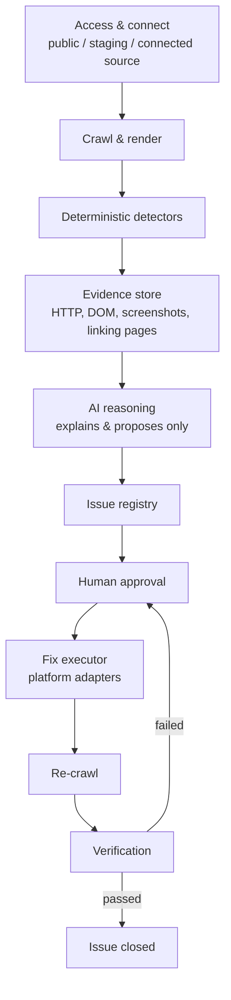

# progrowth-sitefix-agent

An internal AI-assisted agent that inspects any client website, flags
technical, SEO, and accessibility faults with evidence, and, only after
human approval, applies the fix and verifies it actually worked.

This is **not** a website builder and **not** a CMS. It is a technical QA
and error-rectification agent that sits on top of a site that already
exists.

**Status:** Phase 1, Day 5 of 12 complete. See [Current sprint](#10-current-sprint-oct-5-to-oct-17-2026).

---

## 1. Why this exists

Today, when a client site has a problem, the workflow is entirely manual:
someone inspects the site, hunts for broken pages, checks SEO and metadata
by hand, decides what to change, makes the change, and manually re-checks
that it worked. This agent is built to take over that loop (detection,
explanation, proposal, approval, execution, and verification) without
removing the human from any decision that matters.

## 2. The one rule the whole design follows

> **The AI never decides facts. It only explains and proposes.**

A crawler and a set of deterministic checks establish every raw fact (a
status code, a canonical tag, a missing title). Only after a fact exists
does the AI layer explain it in plain language and suggest a fix. The AI
never crawls, never invents a fact, never applies a fix, and never closes
an issue. A human approves every fix before it ships, and a separate
verification step, not the act of applying the fix, is what closes an
issue.

## 3. Architecture



Each stage produces a typed artifact the next stage consumes. Nothing
downstream re-derives a fact a stage above it already established, and
nothing in the pipeline can skip the human-approval step.

## 4. What Phase 1 detects

| Category | What we check for |
|---|---|
| HTTP and URLs | 404 / 410 / 5xx pages, broken links, redirect chains and loops, redirects that end in an error, HTTP/HTTPS and www mismatches |
| Soft 404s | Pages that return 200 OK but read like an error page (not-found title or H1, near-empty body) |
| SEO and metadata | Missing or duplicate titles and meta descriptions, missing H1, broken heading structure |
| Canonical tags | Missing or duplicate canonical tag, canonical pointing to a 404 or to a redirect |
| Sitemap and robots | robots.txt errors, sitemap URLs that error, redirect, or are wrongly marked noindex |
| Images | Broken images, missing alt text, oversized files, HTTP images on HTTPS pages |
| Links | Broken or redirected internal/external links, plus every page that links to the broken one |
| Structured data and accessibility | Invalid schema/Open Graph tags, missing form labels, heading structure, contrast signals |

Every finding carries evidence (a status code, a screenshot, or a DOM
snippet), never a guess. This list is adapted from the overlapping
categories used by established site-audit tools (Semrush, Ahrefs,
Sitebulb), consolidated into a set sized for Phase 1 rather than a full
clone of a mature enterprise crawler.

**Coverage in the current sprint (to Oct 17):** HTTP/URLs, links, redirects,
metadata, canonical tags and soft 404s are built and tested; image and sitemap
checks are basic (Day 7); robots.txt parsing,
structured data and accessibility follow in the next block.

## 5. How a fix is classified

| Fix category | Examples | Who decides the content | Who executes |
|---|---|---|---|
| Safe / deterministic | Redirecting a known-broken link to its one obvious replacement, removing byte-identical duplicate meta tags | A rule engine; the answer is unambiguous | Adapter, after human approval |
| AI-proposed, human-approved | Generating a meta description, choosing a redirect target among several candidates, generating alt text | AI, from evidence only | Adapter, after human approval |
| Detected, not yet automatable | Most performance and accessibility findings; any platform without a working adapter | N/A | Routed to a manual engineering ticket |
| Never autonomous | Deleting pages, changing auth, modifying databases, payment logic, DNS, destructive production changes | N/A | Never this system |

Classification goes by **what the change touches** (which file, API, or
table), not by the issue's category label alone.

## 6. Access model and platform adapters

| Level | What it is | Unlocks |
|---|---|---|
| 1: Public | The live URL, no credentials | Detection only |
| 2: Staging | Login credentials or custom headers for a gated site | Detection on pre-release environments |
| 3: Connected source | GitHub, WordPress, or Webflow access | Required before any fix can be executed |

| Platform | How we connect | How a fix lands |
|---|---|---|
| **GitHub sites (pilot)** | Scoped token or GitHub App, one repo only | Branch, patch, diff, pull request, CI, human merges |
| WordPress | REST API, scoped application password | Title/meta/alt text: direct write. Canonical: only if the site's SEO plugin exposes it for writing (Yoast's REST API is read-only by default). Redirects: need a redirect plugin or server rule |
| Webflow | CMS API; Designer API for structural fields | Content fields via CMS API. Redirects and canonical usually need a manual Designer step |
| Anything else | No adapter built yet | A fully-specified ticket a human applies by hand |

Behind the GitHub adapter, any framework in the repo rides the same
branch/PR/CI flow: Next.js, React, static HTML, PHP/Laravel, custom CMS.
The AI never holds these credentials; only the adapter layer does, and
only after a human approves. None of the adapters are built yet.

## 7. Phase boundaries

- **Phase 1 (this repo):** detect, explain, propose, get human approval,
  execute only low-risk fixes, verify. No content editing, no CMS, no
  autonomous production changes.
- **Phase 2 (later, separate effort):** an editable CMS layer for page
  content, sections and images. Deliberately kept out of Phase 1's schema
  and UI so it can be added later without a rebuild.

**Out of scope for Phase 1:** a visual CMS or content editor, publishing
new pages, autonomous or unapproved production changes, full performance
re-engineering, content strategy work, and heavy infrastructure
(multi-agent orchestration, Kubernetes) before it is needed.

## 8. Tech stack

| Layer | Tool | Status |
|---|---|---|
| Crawler and renderer | Node.js, Playwright (headless Chromium) | In use |
| Test fixture and scoring | Node.js built-ins (`http`, `fetch`) | In use |
| Unit tests | `node:test` (built in) | In use |
| CI | GitHub Actions | In use |
| Issue registry | JSON file now, PostgreSQL later | Planned |
| AI reasoning | Claude API | Planned |
| Fix adapter | GitHub REST API | Planned |
| Secrets | GitHub Actions secrets now, a secrets manager later | Planned |
| Dashboard | React + Tailwind | Planned |

## 9. Repository layout

```
progrowth-sitefix-agent/
├── .github/
│   ├── PULL_REQUEST_TEMPLATE.md      every PR must fill this in
│   └── workflows/
│       ├── crawl.yml                  run the crawler on any URL (manual)
│       └── fixture-selfcheck.yml      unit tests, then crawl and score the fixture on every change
├── fixture/                           controlled test site with planted faults
│   ├── generate-site.js               writes the 13 HTML pages into site/
│   ├── server.js                      serves them with real HTTP redirects
│   ├── selfcheck.js                   proves the fixture behaves as claimed
│   ├── score.js                       scores crawler output against the planted issues
│   ├── expected-issues.json           ground truth: the 12 planted issues
│   └── site/                          generated pages
├── lib/
│   ├── redirects.js                   follow redirects hop by hop, classify them, site-level checks
│   ├── metadata.js                    read title / description / H1 / canonical, apply the metadata rules
│   └── soft404.js                     soft-404 rule: says "not found" plus a second signal
├── test/
│   ├── redirects.test.js              unit tests for lib/redirects.js
│   ├── metadata.test.js               unit tests for lib/metadata.js
│   └── soft404.test.js                unit tests for lib/soft404.js (npm test runs all three)
├── crawl.js                           the crawler (page crawl, link checks, redirect, metadata and soft-404 analysis)
├── package.json
├── .gitignore
└── README.md
```

## 10. Current sprint: Oct 5 to Oct 17, 2026

Goal: turn the Week 1 crawler into a tested detection engine that records
every finding with evidence in an issue registry, with an AI layer that
explains each finding from that evidence only. 12 working days, Monday to
Saturday. Fridays are a half day of build plus review preparation.

| Day | Date | Aim | Status |
|---|---|---|---|
| 1 | Mon Oct 5 | Test fixture with planted faults and ground truth | **Done** |
| 2 | Tue Oct 6 | Crawl coverage: configurable page cap, check every link directly, found-on map | **Done** |
| 3 | Wed Oct 7 | HTTP and redirect detector | **Done** |
| 4 | Thu Oct 8 | Metadata and canonical detector | **Done** |
| 5 | Fri Oct 9 | Soft-404 rule, then Week 1 review prep | **Done** |
| 6 | Sat Oct 10 | Evidence capture and issue schema, registry v0 | Planned |
| 7 | Mon Oct 12 | Registry across runs, image and sitemap checks | Planned |
| 8 | Tue Oct 13 | AI layer: input and output contract | Planned |
| 9 | Wed Oct 14 | AI layer: guardrails and evaluation | Planned |
| 10 | Thu Oct 15 | Readable report | Planned |
| 11 | Fri Oct 16 | Live-site runs, then Week 2 review prep | Planned |
| 12 | Sat Oct 17 | Validation and close-out | Planned |

Beyond this sprint, the Phase 1 plan continues with the approval queue,
the GitHub adapter and the verification engine (re-crawl, then close or
reopen), which together complete the detect-to-verify loop end to end.

## 11. Getting started

Requirements: Node.js 22 or newer, Git.

```bash
git clone https://github.com/indhuja-elumalai/progrowth-sitefix-agent.git
cd progrowth-sitefix-agent
npm install
npx playwright install chromium
```

### Run the crawler

```bash
node crawl.js https://your-site.com --max-pages 100
```

Options: `--max-pages N` (default 100) and `--delay-ms N` (pause between
link checks, default 150). It writes four files:

- `report.json`: one entry per crawled page (raw vs rendered status, title,
  word count, broken resources, and the page's title, meta description, H1s,
  canonical and robots tags as read from both the raw and the rendered HTML).
- `links.json`: a summary, the site-level checks, the most common redirect
  destinations, and one entry per distinct link found, each checked directly
  (HEAD, falling back to GET on 403/405/501, redirects not followed). Every
  link lists the pages it was **found on** and is classed `ok`, `redirect`,
  `broken` (4xx/5xx), `unverified` (timeout, or blocked with 401/403/429/999)
  or `unreachable` (network error). Every redirecting link is followed hop by
  hop (up to 10) and typed as a `redirect-loop`, a `redirect-chain` (2 or more
  hops) or a `redirect-to-error`; a single redirect to a working page is
  recorded but not reported as an issue.
- `metadata.json`: for every page that loads (2xx), the metadata and canonical
  issues found, each with a type, a severity and a one-line detail, plus a
  summary count per type. The rules run on the **rendered** page (what a
  browser and Google end up with); `metadata-js-only` marks a title,
  description, H1 or canonical that is missing from the raw HTML and only
  appears after JavaScript runs.

- `soft404.json`: every page that shows at least one soft-404 signal, with the
  evidence and a `flagged` true/false. Candidates are every page that loaded
  plus up to 20 pages that are only ever reached through redirects (the
  crawler never lands on them directly).

**Soft-404 rule:** a page that answers 200 is flagged only when it says it is an
error page (a not-found phrase or "404" in the title or H1) **and** at least
one other signal agrees: under 150 words, no H1, `noindex`, or 2 or more links
redirect into it. Title and H1 together count as one piece of evidence, and
supporting signals alone never flag a page, so an article about 404 errors or a
short valid page is left alone.

**Metadata rules:** `title-missing`, `title-multiple`, `title-too-long` (over 60
characters), `title-too-short` (under 10), `description-missing`,
`description-multiple`, `description-too-long` (over 160), `description-too-short`
(under 50), `h1-missing`, `h1-multiple`, `canonical-missing`, `canonical-multiple`,
`canonical-broken-target` (the canonical URL returns 4xx/5xx or cannot be
reached), `canonical-redirect`, `title-duplicate`, `description-duplicate` and
`metadata-js-only`. The length limits are common SEO guidance, not facts about
any one site; they live in one place (`LIMITS` in `lib/metadata.js`) and are
severity `low`. A page whose canonical points to a different URL is treated as
a declared copy and is left out of the duplicate checks.

Two site-level checks run on the start URL's host (skipped for localhost):
the `http://` version should redirect to `https://`, and the `www` / non-`www`
twin should redirect to the main host rather than serve the site itself.

It only reads; it never writes to the site.

Or run it with no local setup: GitHub, **Actions**, **Run Crawler**,
**Run workflow**, choose the branch, enter a URL and a `max_pages` value
(the workflow must exist on `main` to appear in that list).

**Known limits of the current crawler:** only `<a href>` links in the
rendered page are checked (not images, scripts or links added after user
interaction); query-string variants of a page are crawled as separate pages;
a link check that times out is reported as `unverified` without a second
attempt (two sonagroup.ae pages timed out at 10 s although `curl` shows them
answering in about 2 s); the soft-404 rule needs the page to say it is an error, so a soft 404 with a
normal title and content is not caught; metadata rules only judge pages the crawler visited
(so a capped crawl does not check every page); a canonical that points to a
redirecting URL is flagged but its final destination is not followed; and there
is no sitemap or image detection yet.

### Run the unit tests and the test fixture

```bash
npm test                              # unit tests for the redirect, metadata and soft-404 logic (no server needed)
```

The fixture is a small site with a known set of planted faults, used to
measure whether each detector finds everything and nothing extra.

```bash
node fixture/generate-site.js         # write the pages (re-run after editing the generator)
node fixture/server.js                # terminal 1: site on :4000, "external" site on :4001
node fixture/selfcheck.js             # terminal 2: expects "All checks passed."
node crawl.js http://localhost:4000   # crawl the fixture
node fixture/score.js                 # compare the crawl with the answer key
```

It uses a local Node server rather than GitHub Pages because Pages cannot
serve real HTTP 301/302 redirects, so a redirect chain or loop cannot be
planted there. The same server runs in CI (`fixture-selfcheck.yml`), which
runs the unit tests, then crawls and scores the fixture on every push.

**Detected so far: 11 of the 12 planted issues**; only F-03 (broken image) is
left, due on Day 7.

**The 12 planted issues** (`fixture/expected-issues.json`):

| ID | Planted fault |
|---|---|
| F-01 | Internal link returns 404 |
| F-02 | External link returns 404 |
| F-03 | Broken image (404) |
| F-04 | Redirect chain, 3 hops |
| F-05 | Redirect loop |
| F-06 | Soft 404 (200 OK, not-found title and H1, short body) |
| F-07 | Missing title |
| F-08, F-09 | Duplicate title (one entry per page) |
| F-10 | Canonical pointing at a 404 |
| F-11 | Redirect that ends in a 404 (`/old-page`) |
| F-12 | Soft 404 reached only through redirects: 200 OK, title says 404, two old links redirect into it (the sonagroup.ae pattern) |

Four control pages (`/`, `/about.html`, `/contact.html`, `/final.html`)
must produce no issues, and the self-check confirms every fixture title and
description is inside the length limits so the length rules stay quiet; `/contact.html` is deliberately short but valid,
to catch soft-404 false alarms. Not yet planted: http-to-https and www
mismatches (they need real hostnames, so they are covered by unit tests with
a fake server), and sitemap and robots faults and image alt text (Day 7).

## 12. Results so far

### Week 1: crawler tested on two live sites

| Site | Finding |
|---|---|
| progrowth.services | Two crawler bugs: `&amp;` in titles read as a JavaScript change, and `/industries/` pages failing to render because they never reach network-idle. Both fixed (entity decoding; wait for `domcontentloaded`). |
| sonagroup.ae | Fixes confirmed on a second site. Found 5 real broken product thumbnails across 4 pages, all under `/public/products-images/thumb-image/`. |

### Day 1: baseline of the Week 1 crawler on the fixture

| Planted issue | What the crawler shows today |
|---|---|
| F-01 internal 404 | Visible (page entry with status 404), not labelled |
| F-02 external 404 | Missed |
| F-03 broken image | Visible (`404 /img/missing.jpg`), not labelled |
| F-04 redirect chain | Visible as a bare 301, hops not counted |
| F-05 redirect loop | Visible as a null render status, not labelled |
| F-06 soft 404 | Missed |
| F-07 missing title | Missed (a false `jsChangedTitle` flag appears instead) |
| F-08, F-09 duplicate titles | Missed |
| F-10 canonical to 404 | Missed |

**4 of 10 have a visible signal, 0 of 10 are labelled as issues, 6 are
missed.** `jsChangedTitle` also gave 4 false flags. Days 2 to 5 close
these gaps; every detector is measured against `expected-issues.json`.

### Day 2: crawl coverage

Page cap replaced by `--max-pages`; every link is now checked directly with
found-on pages. On the fixture the score went from 0 to **2 of 10 planted
issues found** (F-01 internal 404, F-02 external 404, both with the correct
found-on page) with **0 false positives**.

Real-site check (sonagroup.ae, 40 pages crawled with 4,290 still queued, mostly
`products.html` filter variants; 689 links checked): 0 broken, 97 redirecting.
Of the redirects, 9 internal links redirect to `/404.html`, which returns 200
with the title "404" and no H1 (a verified soft 404; `/faqs.html` alone is
linked from every crawled page), 85 are `products.html/?...` filter links that
301 because of a trailing slash, and 3 brand links redirect to the generic
products page. The homepage rejects HEAD requests with 403, so link checks now
retry with GET before judging.

### Day 3: redirect detector

Redirects are followed hop by hop and classified (loop, chain, ends in an
error); the http-to-https and www / non-www checks are in place and
unit-tested (13 tests). The fixture gained a planted fault, F-11 (a redirect
to a 404), and the score went from 2 to **5 of 11 planted issues found**
with **0 false positives** (F-04 chain, F-05 loop and F-11 redirect-to-error
added to F-01 and F-02). `jsChangedTitle` now only compares real pages: 4
false flags on the fixture became 0.

Real-site check (sonagroup.ae, 40 pages, 689 links): 590 ok, 0 broken, 97
redirecting, 2 unverified. All 97 redirects are single-hop: 0 loops, 0 chains,
0 ending in an error. 9 end at `/404.html` and 3 at the generic products page;
because `/404.html` returns 200, the redirect detector does not report them as
an issue, and they appear under "most common redirect destinations" for the
Day 5 soft-404 rule to flag. Site-level checks (http to https, www / non-www)
found nothing; `curl` shows `http://www.sonagroup.ae/` and
`https://sonagroup.ae/` both answering 301. The 2 unverified links were
10-second timeouts on pages that `curl` shows answering 200 in about 2 seconds,
so they are not broken.

### Day 4: metadata and canonical detector

Each page's title, meta description, H1s, canonical and robots tags are read
from both the raw HTML and the rendered page. Rules cover missing, empty,
multiple, too-long and too-short titles and descriptions, missing or multiple
H1s, missing or conflicting canonicals, canonicals that point at an error or a
redirect, duplicate titles and descriptions across pages, and tags that only
exist after JavaScript runs (20 new unit tests, 33 in total). On the fixture
the score went from 5 to **9 of 11 planted issues found** (F-07 missing title,
F-08 and F-09 duplicate title, F-10 canonical to a 404) with **0 false
positives**, and the CI gate was raised from 5 to 9. Only F-03 (image, Day 7)
and F-06 (soft 404, Day 5) are still missed. A throwaway page that injects its
title, description and canonical with JavaScript was correctly reported as
`metadata-js-only`.

### Day 5: soft-404 rule

A page that answers 200 but says "not found" is flagged when a second signal
agrees (almost no text, no H1, `noindex`, or several links redirecting into
it). Pages reached only through redirects are fetched and judged too, because
that is how sonagroup.ae's `/404.html` stays hidden: the crawler never lands on
it directly. The fixture gained F-12, a page modelled on that case (13 pages
now), and 9 new unit tests bring the total to 42. The score went from 9 to
**11 of 12 planted issues found** with **0 false positives**, and the CI gate
was raised from 9 to 11. Only F-03 (image, Day 7) is still missed.
Real-site check (sonagroup.ae, 40 pages crawled, 42 judged including 2 reached
only through redirects): exactly one soft 404 flagged, `/404.html`, which
answers 200 with the title "404", no H1, and 9 internal links redirecting into
it. The crawler never visits that page directly, so it was found through the
redirect destinations. No other page was flagged. The earlier link checks
could not catch this, because every redirect to it looks healthy (a single hop
to a 200 page).

## 13. Security principles

- Every client site is its own isolated tenant: separate credentials,
  separate evidence storage, separate issue registry partition.
- Credentials live only in a secrets manager (GitHub Actions secrets
  during development), never in code, config, or logs.
- Each adapter requests the narrowest possible scope (one repo, one
  application-password user), never admin or org-wide access.
- The AI reasoning service never holds fix-execution credentials; that is
  an architectural boundary, not a permissions setting.
- Every fix requires human approval. No silent auto-apply exists in
  Phase 1, even for "safe/deterministic" fixes.
- Every stage (detection, proposal, approval, execution, verification)
  is logged append-only and tied to the issue it belongs to.

## 14. Contributing

Work is done on short-lived branches off `main` (`feature/...`, `fix/...`,
`chore/...`), merged by pull request, and the branch is deleted after
merging. `main` is never pushed to directly.

Every PR uses [`.github/PULL_REQUEST_TEMPLATE.md`](.github/PULL_REQUEST_TEMPLATE.md):
what it does, which roadmap item it closes, how it was tested, the
outcome, and any risk notes. A PR is done when its checks pass (unit tests
and the fixture score) and it is merged to `main`. Never commit tokens,
`.env` files, `report.json`, `links.json`, `metadata.json` or `soft404.json`.